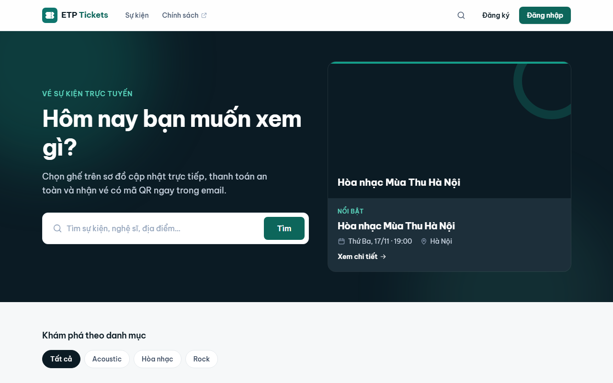
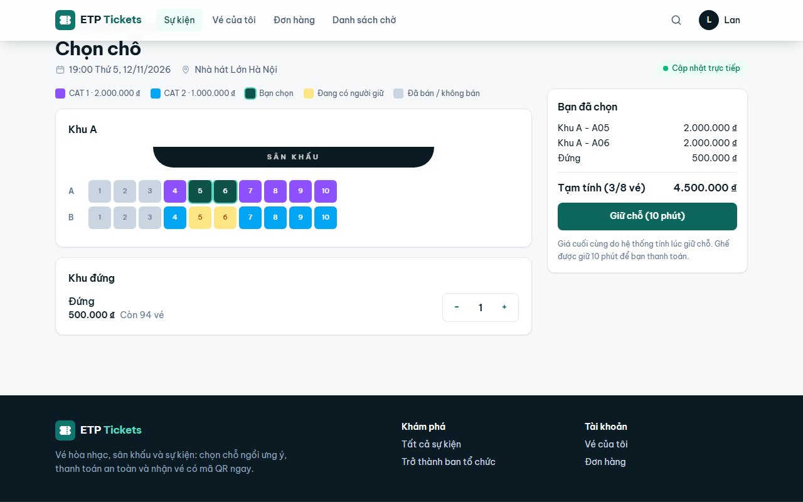
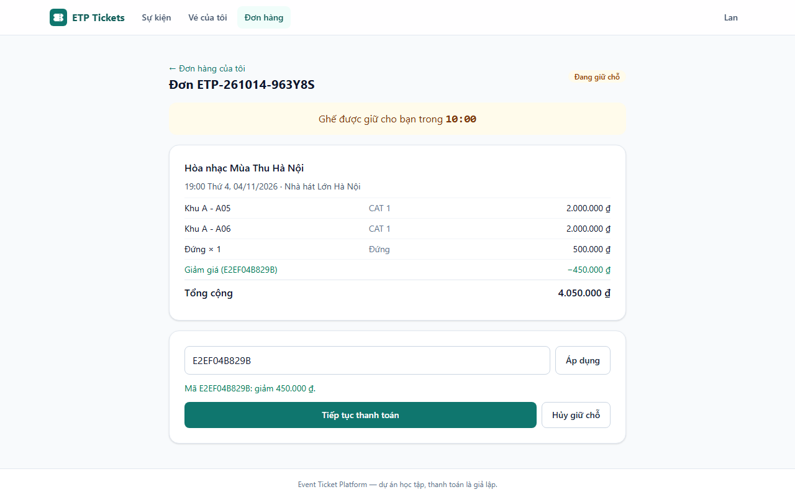
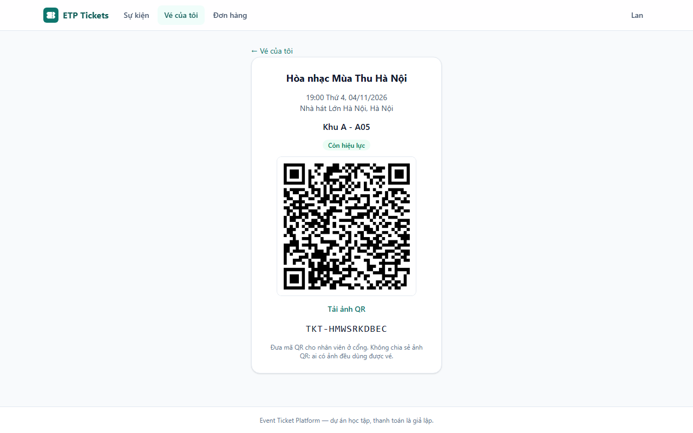
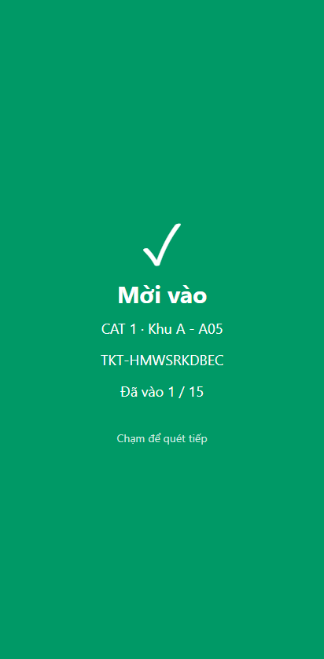
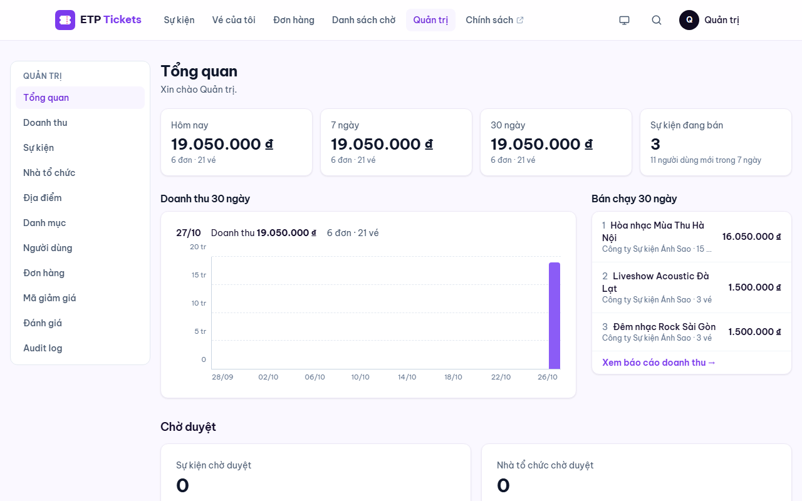
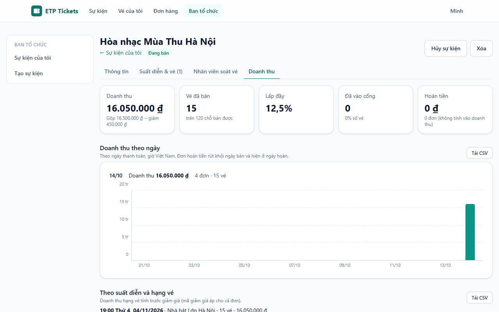
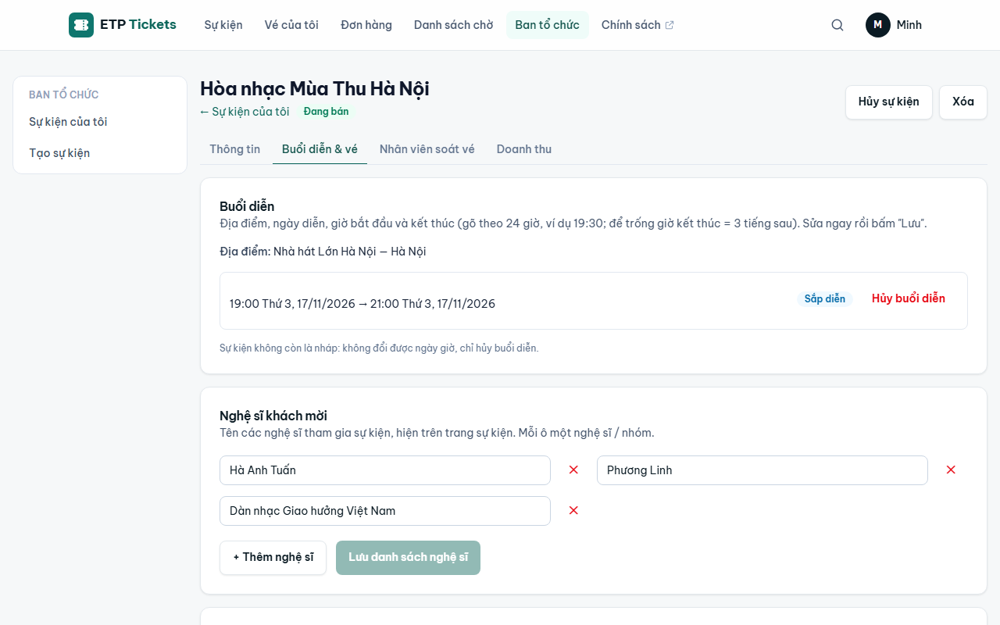
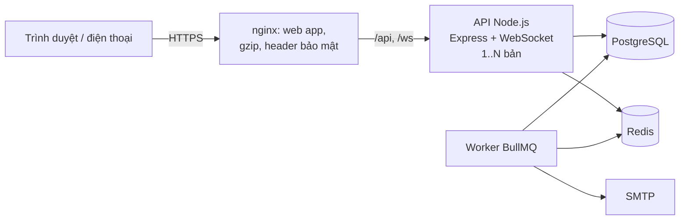

# Cticket: Event Ticket Platform

[](https://github.com/Vietnguyen203/Cticket/actions/workflows/ci.yml)

> **English summary.** A ticketing platform for concerts and events, built as a learning project with production habits: a Node.js modular monolith (Express, PostgreSQL, Redis, BullMQ, WebSocket) and a React web app. Buyers pick seats on a **live seat map**, hold them for 10 minutes (and can swap seats in the held order without losing the others), pay through **VNPay** (sandbox: signed IPN, query-back, reconciliation, automatic refunds of late payments) or a simulator, and get **QR tickets** (a printable PDF in the confirmation email) with email reminders before the show; they can cancel under the event's refund policy (partial refunds), wait their turn in a **purchase queue** when the organizer switches it on for a rush, or join a **waiting list** that keeps freed places for them for 30 minutes; people who went in **review** the event (stars, comment, organizer replies, admin moderation); gate staff scan them with a **phone camera**; organizers build events and seat plans and follow their sales; admins approve, refund and see platform reports. **Two-factor authentication** with an authenticator app (TOTP, written from RFC 6238), required for admins, and a per-email lock after repeated wrong passwords. Buyers accept **terms of sale** written as a Vietnamese contract (legal bases linked), can **download their personal data** and **delete their account** (anonymised, orders kept for the accounts). **No seat is ever sold twice**: Redis filters the rush, PostgreSQL row locks and constraints decide (proven by 100-buyers-one-seat tests and a 500-user k6 load test). 429 backend tests, 129 web tests, 29 Playwright end-to-end tests, CI on GitHub Actions. Ready to deploy on one VPS with Docker Compose: Caddy (automatic HTTPS), deploy on green CI with automatic fallback, nightly backups with tested restores. Documentation is in Vietnamese.

Nền tảng bán vé sự kiện (concert, sân khấu…), làm như một dự án học tập nhưng theo thói quen của sản phẩm thật: thiết kế trước rồi mới code, test ở nhiều tầng, đo tải, tài liệu cho từng phase.



## Tính năng

**Khách hàng**
- Tìm sự kiện (không dấu cũng tìm được), xem lịch diễn và giá.
- **Hàng chờ mua vé** khi mở bán đông khách (ban tổ chức bật): chỉ N người chọn chỗ cùng lúc, người đến sau thấy vị trí của mình và tự được vào khi tới lượt.
- **Sơ đồ ghế cập nhật trực tiếp**: ghế người khác vừa giữ đổi màu ngay, không cần tải lại; ghế đang chọn bị người khác lấy thì tự bỏ ra và báo.
- Giữ chỗ 10 phút (đồng hồ theo giờ server), mã giảm giá.
- **Thanh toán qua VNPay** (sandbox): kết quả nhận bằng IPN có chữ ký và hỏi lại VNPay, đơn hết giờ khi đang trả thì đối soát trước khi mở bán lại ghế; tiền đến muộn hoặc trả trùng được **hoàn tự động**. Thêm thanh toán giả lập để thử (bấm hai lần không bị trừ tiền hai lần), tắt mặc định trên production.
- **Đổi / bỏ ghế trong đơn đang giữ**: ghế cũ vẫn là của mình cho tới khi đổi xong, không phải hủy đơn rồi đặt lại.
- Vé có **mã QR** (ký số, cấp lại được), **vé PDF** (mỗi vé một trang, đính kèm email xác nhận, tải ở trang đơn / trang vé), email xác nhận, thông báo, **nhắc lịch** 24 giờ và 2 giờ trước giờ diễn (tắt được).
- **Tự hủy đơn theo chính sách hoàn của sự kiện** (Không hoàn / Tiêu chuẩn / Linh hoạt): thấy trước số tiền được hoàn, hoàn một phần qua VNPay, phần còn lại là phí hủy.
- **Đánh giá sự kiện** (1–5 sao, nhận xét): chỉ người đã vào cổng mới viết được, có nhãn "Đã đi xem"; điểm trung bình trên trang sự kiện và danh sách; email mời đánh giá một ngày sau buổi diễn.
- **Danh sách chờ** khi hạng vé hết: có vé trả lại thì người chờ sớm nhất được báo và được giữ vé 30 phút để đặt.

**Ban tổ chức**
- Tạo sự kiện (một buổi diễn, giờ gõ theo 24 giờ), nghệ sĩ khách mời; tổng số người tham dự theo sức chứa địa điểm, gán hạng vé cho từng khu có sẵn (khu ngồi / khu đứng); khóa / mở ghế; đề xuất địa điểm mới; tải ảnh lên; chọn chính sách hủy đơn; bật **hàng chờ mua vé** và xem số người đang mua / đang chờ; trả lời công khai các đánh giá.
- Thêm nhân viên soát vé; **báo cáo doanh thu** theo suất / hạng vé, tỷ lệ lấp đầy, số người đã vào cổng, xuất CSV.

**Nhân viên soát vé**
- Quét QR bằng **camera điện thoại** ngay trên web (hoặc máy quét cầm tay): màn hình xanh "Mời vào" / đỏ kèm lý do (vé đã dùng lúc nào, ở cổng nào, sai suất…), bộ đếm cập nhật trực tiếp giữa các cổng.

**Tài khoản**
- **Xác thực hai lớp** bằng ứng dụng trên điện thoại (Google / Microsoft Authenticator, Authy): mã 6 số đổi mỗi 30 giây, 10 mã khôi phục dùng một lần, email cảnh báo khi bật / tắt / bị đặt lại. **Bắt buộc với quản trị viên**; người khác tự chọn bật.
- **Khóa đăng nhập tạm thời** khi sai mật khẩu (hoặc mã 2FA) 5 lần liền: 15 phút, lần sau lâu gấp đôi; tính theo email, kể cả email không tồn tại; đặt lại mật khẩu hoặc admin mở khóa được ngay.
- **Dữ liệu cá nhân** (Luật Bảo vệ dữ liệu cá nhân 2025): trang Tài khoản cho tải toàn bộ dữ liệu đang lưu (file JSON) và tự xóa tài khoản. Xóa thì thông tin cá nhân mất hẳn, đăng xuất mọi thiết bị; đơn hàng, thanh toán, hoàn tiền giữ ở dạng ẩn danh để đối soát. Chưa xóa được khi còn vé sắp diễn, đơn dở dang hoặc hoàn tiền đang chờ.

**Quản trị**
- Duyệt nhà tổ chức và sự kiện, quản lý địa điểm / sơ đồ ghế, danh mục, người dùng và vai trò, đơn hàng và **hoàn tiền**, mã giảm giá, ẩn đánh giá vi phạm, **audit log**, dashboard và báo cáo doanh thu toàn hệ thống.

| Chọn ghế | Giữ chỗ, mã giảm giá | Vé QR | Soát vé trên điện thoại |
|---|---|---|---|
|  |  |  |  |

| Dashboard quản trị | Doanh thu của ban tổ chức | Buổi diễn, nghệ sĩ khách mời, hạng vé |
|---|---|---|
|  |  |  |

## Kiến trúc



- **Modular monolith**: 17 module (auth, events, orders, payments, tickets, checkins, reports…), mỗi module `routes → controller → service → repository`, gọi nhau qua API công khai của module.
- **Không bán trùng ghế**: Redis chặn sớm phần lớn request tranh cùng ghế (gợi ý ghế đã có người lấy, khóa ngắn hạn), **PostgreSQL quyết định** (khóa dòng theo thứ tự cố định, cập nhật có điều kiện, ràng buộc `UNIQUE` / `CHECK`). Redis hỏng thì chậm hơn, không sai.
- Việc bên ngoài DB (WebSocket, hàng đợi) chỉ chạy **sau khi commit**; worker phát vé, gửi email, hết hạn giữ chỗ, tự phát bù vé nếu job bị mất.
- Xác thực: access token trong bộ nhớ, refresh token **cookie httpOnly** xoay vòng và phát hiện dùng lại, denylist khi đăng xuất / khóa tài khoản, RBAC, **2FA (TOTP)** với secret mã hóa AES-256-GCM và mỗi mã chỉ dùng một lần.

Chi tiết: [docs/architecture.md](docs/architecture.md).

## Công nghệ

| Phần | Công nghệ |
|---|---|
| Backend | Node.js 24, Express 5, PostgreSQL 17 (`pg`, SQL viết tay, node-pg-migrate), Redis 7.4 (ioredis, Lua), BullMQ, `ws`, zod, JWT, bcrypt, Nodemailer, pino |
| Web | React 19, TypeScript, Vite, Tailwind CSS 4, React Router, Axios |
| Kiểm thử | Jest + Supertest (DB và Redis thật), Vitest, Playwright, k6 |
| Hạ tầng | Docker Compose, nginx, GitHub Actions, Mailpit |

## Chạy nhanh bằng Docker

Cần: Docker Desktop, Node.js 24 (để tạo secret). Trên Windows PowerShell 5.1 chạy từng lệnh (không dùng `&&`).

```bash
git clone https://github.com/Vietnguyen203/Cticket.git
cd Cticket
cp .env.example .env
```

Mở `.env`, đặt `POSTGRES_PASSWORD`, `REDIS_PASSWORD` và 3 secret `JWT_ACCESS_SECRET`, `OTP_SECRET`, `QR_SECRET` (mỗi cái một chuỗi ngẫu nhiên khác nhau):

```bash
node -e "console.log(require('crypto').randomBytes(48).toString('base64url'))"
```

và `TOTP_ENCRYPTION_KEY` (đúng 32 byte, mã hóa secret xác thực hai lớp):

```bash
node -e "console.log(require('crypto').randomBytes(32).toString('base64'))"
```

Khởi động (lần đầu build vài phút; migration tự chạy):

```bash
docker compose up -d --build
```

Tạo tài khoản quản trị:

```bash
docker compose exec -e ADMIN_EMAIL=admin@example.com -e ADMIN_PASSWORD=MatKhauManh123 api npm run seed:admin
```

| Địa chỉ | Là gì |
|---|---|
| http://localhost:8080 | Web app |
| https://localhost:8443 | Web app qua HTTPS (chứng chỉ tự ký; dùng cho điện thoại cùng Wi-Fi: `https://<IP máy tính>:8443`, cần cho camera) |
| http://localhost:8025 | Mailpit: hộp thư nhận mọi email (mã OTP khi đăng ký) |
| http://localhost:3001/health/ready | API (cổng đổi bằng `API_PORT`) |

Lần đầu đăng nhập admin, trang sẽ yêu cầu **thiết lập xác thực hai lớp**: quét mã QR bằng ứng dụng xác thực trên điện thoại, nhập mã 6 số, cất 10 mã khôi phục. Đăng ký một tài khoản khách (lấy mã OTP trong Mailpit), đăng nhập admin để duyệt nhà tổ chức / sự kiện. Muốn gửi email thật thì đặt `SMTP_*` trong `.env`.

### Thử thanh toán VNPay (sandbox)

Không có cấu hình VNPay thì trang đơn chỉ có thanh toán giả lập. Để thử VNPay:

1. Đăng ký tài khoản sandbox tại http://sandbox.vnpayment.vn/devreg/. VNPay gửi email có **mã website (`vnp_TmnCode`)**, **chuỗi bí mật (`vnp_HashSecret`)** và thẻ test (ngân hàng NCB).
2. Điền `VNPAY_TMN_CODE` và `VNPAY_HASH_SECRET` vào `.env` (không bao giờ commit, không dán vào chat), rồi `docker compose up -d`.
3. Trên trang đơn, bấm **"Thanh toán … qua VNPay"**, trả bằng thẻ test; VNPay đưa bạn về `http://localhost:8080/payments/vnpay/return`, API hỏi lại VNPay rồi hiện kết quả.
4. Muốn IPN (VNPay gọi thẳng máy chủ) tới được máy bạn: mở tunnel `docker compose --profile tunnel up -d tunnel`, lấy địa chỉ `https://….trycloudflare.com` trong `docker compose logs tunnel`, khai báo IPN URL `<địa chỉ đó>/api/v1/payments/vnpay/ipn` trong trang quản lý merchant sandbox của VNPay. Tắt tunnel khi thử xong.

Chi tiết và các tình huống (khách hủy, tiền đến muộn, hoàn tiền): [docs/phase-17-vnpay-design.md](docs/phase-17-vnpay-design.md).

## Triển khai lên VPS

Một VPS Ubuntu 24.04, mọi thứ trong Docker Compose (`deploy/`):
- **Caddy** tự lấy và gia hạn chứng chỉ HTTPS.
- Mỗi lần CI xanh trên `main` thì **tự deploy**: build ngay trên máy chủ, sao lưu, migration, kiểm tra sức khỏe; bản mới không khỏe thì **tự quay về bản trước**.
- **Sao lưu hằng đêm**, có script khôi phục.
- Máy chủ chỉ mở 22 / 80 / 443, đăng nhập SSH bằng khóa.

Toàn bộ quy trình đã chạy thử trên máy tính, và CI dựng lại stack production mỗi lần push. Hướng dẫn từng bước: [docs/deployment.md](docs/deployment.md).

## Phát triển

**Web app** (tự tải lại khi sửa code), dùng API đang chạy trong Docker:

```bash
cd frontend
npm install
npm run dev
```

Mở http://localhost:5173. Vite chuyển `/api`, `/ws` tới `http://localhost:3001`; đổi đích bằng biến `API_PROXY_TARGET`. `npm run dev:https` để mở từ điện thoại (camera cần HTTPS).

**API chạy ngoài Docker** (tự khởi động lại khi sửa code). Cần PostgreSQL, Redis, Mailpit trong Docker (`docker compose up -d postgres redis mailpit`), rồi:

```bash
cd backend
cp .env.example .env
npm install
npm run migrate:up
npm run dev
```

API này nghe cổng 3000 (`PORT` trong `backend/.env`); việc nền chạy bằng `npm run worker` ở một terminal khác. Cho web dùng API này: đặt `API_PROXY_TARGET=http://localhost:3000` trước khi `npm run dev` web (PowerShell: `$env:API_PROXY_TARGET="http://localhost:3000"`).

## Kiểm thử

| Tầng | Lệnh | Số lượng |
|---|---|---|
| Backend (Jest, PostgreSQL + Redis thật) | `cd backend` → `npm test` / `npm run test:coverage` | 429 test, độ phủ 96,1% dòng (CI chặn nếu dưới 90%) |
| Web (Vitest) | `cd frontend` → `npm test` | 129 test |
| End-to-end (Playwright) | `cd e2e` → `npm install` → `npx playwright install chromium` → `npm test` | 29 kịch bản (có cảnh 2 trình duyệt cùng xem sơ đồ ghế, admin thiết lập 2FA lần đầu, trả qua một VNPay giả, hủy đơn theo chính sách, danh sách chờ, đánh giá, tải vé PDF, hàng chờ mua vé) |
| Tải (k6) | xem `docs/testing.md` | 5 kịch bản, số người dùng cùng lúc chọn khi chạy (`-e VUS=1000`) |

Test đồng thời đáng chú ý: **100 người cùng giữ 1 ghế → đúng 1 người được** (kể cả khi tắt Redis); 2 cổng quét cùng 1 vé cùng lúc → vào đúng 1 lần; cùng `Idempotency-Key` gửi 5 lần → thanh toán 1 lần.

**Load test** (laptop, 1 bản API): duyệt sự kiện 300 người dùng ảo p95 5,7 ms; hỗn hợp duyệt / xem sơ đồ / mua 200 người dùng ảo trong 5 phút: giữ chỗ p95 71 ms, thanh toán p95 52 ms, 0% lỗi, 2.819 lượt mua; tranh ghế 500 người / 50 ghế: không ghế nào bán trùng. Hàng chờ mua vé 1.000 người cùng vào, N = 50: không lúc nào quá 50 người mua, cả 1.000 người mua được, 0% lỗi. Load test dẫn tới 4 cải tiến (keep-alive sau proxy, gợi ý ghế trong Redis, gzip, nhiều bản API).

Chi tiết: [docs/testing.md](docs/testing.md). CI (GitHub Actions) chạy backend, web, E2E và dựng thử stack production (deploy, smoke test, sao lưu → khôi phục) mỗi lần push.

## Cấu trúc thư mục

```
backend/     API + worker (src/modules/<module>, migrations/, tests/)
frontend/    Web app React (src/pages, src/api, src/realtime, ...), Dockerfile nginx
e2e/         Test Playwright (môi trường riêng: database etp_e2e, Mailpit)
loadtest/    k6: stack riêng, dữ liệu mẫu, 5 kịch bản (số người dùng chọn khi chạy), kiểm tra dữ liệu sau khi chạy
postman/     Collection Postman theo từng phase
docs/        Thiết kế từng phase, kiến trúc, kiểm thử, checklist production, ảnh chụp
```

## Tài liệu

- [Kiến trúc](docs/architecture.md) · [Kiểm thử](docs/testing.md) · [Triển khai lên VPS](docs/deployment.md) · [Checklist production](docs/production-checklist.md)
- Thiết kế và ghi chú theo phase: [4 sơ đồ ghế, tồn kho](docs/phase-4-inventory-design.md) · [5 đặt chỗ](docs/phase-5-booking-design.md) · [6 Redis](docs/phase-6-redis-design.md) · [7 WebSocket](docs/phase-7-websocket-design.md) · [8 thanh toán](docs/phase-8-payments-design.md) · [9 hàng đợi](docs/phase-9-queue-design.md) · [10 soát vé](docs/phase-10-checkin-design.md) · [11 web](docs/phase-11-web-design.md) · [12 quản trị](docs/phase-12-admin-web-design.md) · [12.4 báo cáo](docs/phase-12.4-reports-design.md) · [13 kiểm thử](docs/phase-13-testing-design.md) · [14 hardening](docs/phase-14-hardening-design.md) · [BKG-02 đổi ghế trong đơn đang giữ](docs/bkg-02-edit-held-order-design.md) · [15 xác thực hai lớp](docs/phase-15-two-factor-design.md) · [16 triển khai](docs/phase-16-deployment-design.md) · [17 VNPay](docs/phase-17-vnpay-design.md) · [18 khóa đăng nhập, nhắc lịch, hủy đơn, danh sách chờ](docs/phase-18-customer-features-design.md) · [19 đánh giá](docs/phase-19-reviews-design.md) · [20 vé PDF](docs/phase-20-ticket-pdf-design.md) · [21 hàng chờ mua vé](docs/phase-21-queue-design.md) · [22 giả lập tải](docs/phase-22-load-config-design.md) · [rà soát lỗi](docs/bug-review.md) · [giao diện](docs/ui-redesign.md) · [**kịch bản test**](docs/test-scenarios.md) · [**hướng dẫn test trên giao diện**](docs/ui-test-guide.md)

Ảnh chụp màn hình được tạo tự động (`cd e2e` → `npm run screenshots`, dữ liệu mẫu).

## Giới hạn và hướng phát triển

- **VNPay mới chạy với sandbox**: dùng tiền thật cần hợp đồng với VNPay (mã website và địa chỉ production) — xem checklist production. Chính sách hủy là 3 mẫu cố định (ban tổ chức chưa tự đặt % và mốc).
- Chưa có: chuyển nhượng vé. Phần triển khai đã sẵn sàng nhưng chưa chạy trên máy chủ thật (cần VPS và tên miền).
- Ảnh tải lên lưu trên ổ đĩa của API: nhiều máy chủ thì chuyển sang kho chung (S3…).
- Một tiến trình Node.js dùng một nhân CPU: tải lớn thì chạy nhiều bản API sau load balancer (đã thử trong load test).
