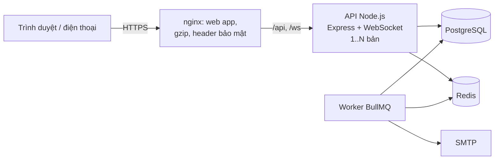

# Cticket: Event Ticket Platform

[](https://github.com/Vietnguyen203/Cticket/actions/workflows/ci.yml)

> **English summary.** A ticketing platform for concerts and events, built as a learning project with production habits: a Node.js modular monolith (Express, PostgreSQL, Redis, BullMQ, WebSocket) and a React web app. Buyers pick seats on a **live seat map**, hold them for 10 minutes (and can swap seats in the held order without losing the others), pay (simulated, idempotent) and get **QR tickets**; gate staff scan them with a **phone camera**; organizers build events and seat plans and follow their sales; admins approve, refund and see platform reports. **No seat is ever sold twice**: Redis filters the rush, PostgreSQL row locks and constraints decide (proven by 100-buyers-one-seat tests and a 500-user k6 load test). 269 backend tests, 63 web tests, 12 Playwright end-to-end tests, CI on GitHub Actions. Documentation is in Vietnamese.

Nền tảng bán vé sự kiện (concert, sân khấu…), làm như một dự án học tập nhưng theo thói quen của sản phẩm thật: thiết kế trước rồi mới code, test ở nhiều tầng, đo tải, tài liệu cho từng phase.


## Tính năng

**Khách hàng**
- Tìm sự kiện (không dấu cũng tìm được), xem lịch diễn và giá.
- **Sơ đồ ghế cập nhật trực tiếp**: ghế người khác vừa giữ đổi màu ngay, không cần tải lại; ghế đang chọn bị người khác lấy thì tự bỏ ra và báo.
- Giữ chỗ 10 phút (đồng hồ theo giờ server), mã giảm giá, thanh toán giả lập (bấm hai lần không bị trừ tiền hai lần).
- **Đổi / bỏ ghế trong đơn đang giữ**: ghế cũ vẫn là của mình cho tới khi đổi xong, không phải hủy đơn rồi đặt lại.
- Vé có **mã QR** (ký số, cấp lại được), email xác nhận, thông báo.

**Ban tổ chức**
- Tạo sự kiện, suất diễn, hạng vé, gán ghế theo hàng; khóa / mở ghế; đề xuất địa điểm mới; tải ảnh lên.
- Thêm nhân viên soát vé; **báo cáo doanh thu** theo suất / hạng vé, tỷ lệ lấp đầy, số người đã vào cổng, xuất CSV.

**Nhân viên soát vé**
- Quét QR bằng **camera điện thoại** ngay trên web (hoặc máy quét cầm tay): màn hình xanh "Mời vào" / đỏ kèm lý do (vé đã dùng lúc nào, ở cổng nào, sai suất…), bộ đếm cập nhật trực tiếp giữa các cổng.

**Quản trị**
- Duyệt nhà tổ chức và sự kiện, quản lý địa điểm / sơ đồ ghế, danh mục, người dùng và vai trò, đơn hàng và **hoàn tiền**, mã giảm giá, **audit log**, dashboard và báo cáo doanh thu toàn hệ thống.

| Chọn ghế | Giữ chỗ, mã giảm giá | Vé QR | Soát vé trên điện thoại |
|---|---|---|---|
|  |  |  |  |

| Dashboard quản trị | Doanh thu của ban tổ chức | Suất diễn, hạng vé, khóa ghế |
|---|---|---|
|  |  |  |

## Kiến trúc



- **Modular monolith**: 17 module (auth, events, orders, payments, tickets, checkins, reports…), mỗi module `routes → controller → service → repository`, gọi nhau qua API công khai của module.
- **Không bán trùng ghế**: Redis chặn sớm phần lớn request tranh cùng ghế (gợi ý ghế đã có người lấy, khóa ngắn hạn), **PostgreSQL quyết định** (khóa dòng theo thứ tự cố định, cập nhật có điều kiện, ràng buộc `UNIQUE` / `CHECK`). Redis hỏng thì chậm hơn, không sai.
- Việc bên ngoài DB (WebSocket, hàng đợi) chỉ chạy **sau khi commit**; worker phát vé, gửi email, hết hạn giữ chỗ, tự phát bù vé nếu job bị mất.
- Xác thực: access token trong bộ nhớ, refresh token **cookie httpOnly** xoay vòng và phát hiện dùng lại, denylist khi đăng xuất / khóa tài khoản, RBAC.

Chi tiết: [docs/architecture.md](docs/architecture.md).

## Công nghệ

| Phần | Công nghệ |
|---|---|
| Backend | Node.js 24, Express 5, PostgreSQL 17 (`pg`, SQL viết tay, node-pg-migrate), Redis 7.4 (ioredis, Lua), BullMQ, `ws`, zod, JWT, bcrypt, Nodemailer, pino |
| Web | React 19, TypeScript, Vite, Tailwind CSS 4, React Router, Axios |
| Kiểm thử | Jest + Supertest (DB và Redis thật), Vitest, Playwright, k6 |
| Hạ tầng | Docker Compose, nginx, GitHub Actions, Mailpit |

## Chạy nhanh bằng Docker

Cần: Docker Desktop, Node.js 24 (để tạo secret). Trên Windows PowerShell 5.1 chạy từng lệnh (không dùng `&&`).

```bash
git clone https://github.com/Vietnguyen203/Cticket.git
cd Cticket
cp .env.example .env
```

Mở `.env`, đặt `POSTGRES_PASSWORD`, `REDIS_PASSWORD` và 3 secret `JWT_ACCESS_SECRET`, `OTP_SECRET`, `QR_SECRET` (mỗi cái một chuỗi ngẫu nhiên khác nhau):

```bash
node -e "console.log(require('crypto').randomBytes(48).toString('base64url'))"
```

Khởi động (lần đầu build vài phút; migration tự chạy):

```bash
docker compose up -d --build
```

Tạo tài khoản quản trị:

```bash
docker compose exec -e ADMIN_EMAIL=admin@example.com -e ADMIN_PASSWORD=MatKhauManh123 api npm run seed:admin
```

| Địa chỉ | Là gì |
|---|---|
| http://localhost:8080 | Web app |
| https://localhost:8443 | Web app qua HTTPS (chứng chỉ tự ký; dùng cho điện thoại cùng Wi-Fi: `https://<IP máy tính>:8443`, cần cho camera) |
| http://localhost:8025 | Mailpit: hộp thư nhận mọi email (mã OTP khi đăng ký) |
| http://localhost:3001/health/ready | API (cổng đổi bằng `API_PORT`) |

Đăng ký một tài khoản (lấy mã OTP trong Mailpit), đăng nhập admin để duyệt nhà tổ chức / sự kiện. Muốn gửi email thật thì đặt `SMTP_*` trong `.env`.

## Phát triển

**Web app** (tự tải lại khi sửa code), dùng API đang chạy trong Docker:

```bash
cd frontend
npm install
npm run dev
```

Mở http://localhost:5173. Vite chuyển `/api`, `/ws` tới `http://localhost:3001`; đổi đích bằng biến `API_PROXY_TARGET`. `npm run dev:https` để mở từ điện thoại (camera cần HTTPS).

**API chạy ngoài Docker** (tự khởi động lại khi sửa code). Cần PostgreSQL, Redis, Mailpit trong Docker (`docker compose up -d postgres redis mailpit`), rồi:

```bash
cd backend
cp .env.example .env
npm install
npm run migrate:up
npm run dev
```

API này nghe cổng 3000 (`PORT` trong `backend/.env`); việc nền chạy bằng `npm run worker` ở một terminal khác. Cho web dùng API này: đặt `API_PROXY_TARGET=http://localhost:3000` trước khi `npm run dev` web (PowerShell: `$env:API_PROXY_TARGET="http://localhost:3000"`).

## Kiểm thử

| Tầng | Lệnh | Số lượng |
|---|---|---|
| Backend (Jest, PostgreSQL + Redis thật) | `cd backend` → `npm test` / `npm run test:coverage` | 269 test, độ phủ 94,8% dòng (CI chặn nếu dưới 90%) |
| Web (Vitest) | `cd frontend` → `npm test` | 63 test |
| End-to-end (Playwright) | `cd e2e` → `npm install` → `npx playwright install chromium` → `npm test` | 12 kịch bản (có cảnh 2 trình duyệt cùng xem sơ đồ ghế) |
| Tải (k6) | xem `docs/testing.md` | 4 kịch bản |

Test đồng thời đáng chú ý: **100 người cùng giữ 1 ghế → đúng 1 người được** (kể cả khi tắt Redis); 2 cổng quét cùng 1 vé cùng lúc → vào đúng 1 lần; cùng `Idempotency-Key` gửi 5 lần → thanh toán 1 lần.

**Load test** (laptop, 1 bản API): duyệt sự kiện 300 người dùng ảo p95 5,7 ms; hỗn hợp duyệt / xem sơ đồ / mua 200 người dùng ảo trong 5 phút: giữ chỗ p95 71 ms, thanh toán p95 52 ms, 0% lỗi, 2.819 lượt mua; tranh ghế 500 người / 50 ghế: không ghế nào bán trùng. Load test dẫn tới 4 cải tiến (keep-alive sau proxy, gợi ý ghế trong Redis, gzip, nhiều bản API).

Chi tiết: [docs/testing.md](docs/testing.md). CI (GitHub Actions) chạy backend, web và E2E mỗi lần push.

## Cấu trúc thư mục

```
backend/     API + worker (src/modules/<module>, migrations/, tests/)
frontend/    Web app React (src/pages, src/api, src/realtime, ...), Dockerfile nginx
e2e/         Test Playwright (môi trường riêng: database etp_e2e, Mailpit)
loadtest/    k6: stack riêng, dữ liệu mẫu, 4 kịch bản, kiểm tra dữ liệu sau khi chạy
postman/     Collection Postman theo từng phase
docs/        Thiết kế từng phase, kiến trúc, kiểm thử, checklist production, ảnh chụp
```

## Tài liệu

- [Kiến trúc](docs/architecture.md) · [Kiểm thử](docs/testing.md) · [Checklist production](docs/production-checklist.md)
- Thiết kế và ghi chú theo phase: [4 sơ đồ ghế, tồn kho](docs/phase-4-inventory-design.md) · [5 đặt chỗ](docs/phase-5-booking-design.md) · [6 Redis](docs/phase-6-redis-design.md) · [7 WebSocket](docs/phase-7-websocket-design.md) · [8 thanh toán](docs/phase-8-payments-design.md) · [9 hàng đợi](docs/phase-9-queue-design.md) · [10 soát vé](docs/phase-10-checkin-design.md) · [11 web](docs/phase-11-web-design.md) · [12 quản trị](docs/phase-12-admin-web-design.md) · [12.4 báo cáo](docs/phase-12.4-reports-design.md) · [13 kiểm thử](docs/phase-13-testing-design.md) · [14 hardening](docs/phase-14-hardening-design.md) · [BKG-02 đổi ghế trong đơn đang giữ](docs/bkg-02-edit-held-order-design.md)

Ảnh chụp màn hình được tạo tự động (`cd e2e` → `npm run screenshots`, dữ liệu mẫu).

## Giới hạn và hướng phát triển

- **Thanh toán là giả lập**: thay bằng cổng thật (webhook có chữ ký, đối soát) — xem checklist production.
- Chưa có: xác thực hai lớp, khóa tài khoản sau nhiều lần sai mật khẩu (đã có rate limit theo IP), triển khai lên cloud.
- Ảnh tải lên lưu trên ổ đĩa của API: nhiều máy chủ thì chuyển sang kho chung (S3…).
- Một tiến trình Node.js dùng một nhân CPU: tải lớn thì chạy nhiều bản API sau load balancer (đã thử trong load test).
