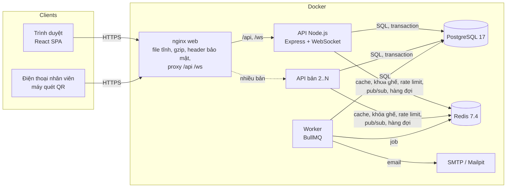
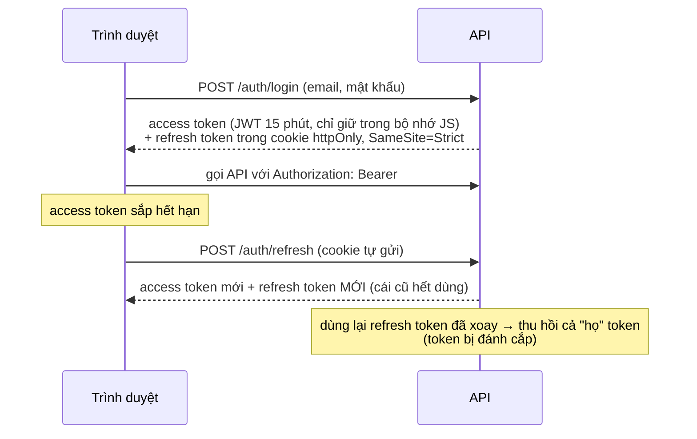

# Kiến trúc

Event Ticket Platform là một **modular monolith**: một API Node.js chia thành các module có ranh giới rõ ràng, một tiến trình **worker** chạy việc nền, một **web app** React. PostgreSQL là nguồn dữ liệu duy nhất đáng tin; Redis để tăng tốc và phối hợp, **mất Redis thì hệ thống chậm đi chứ không sai**.

## 1. Tổng quan



- **nginx `web`** phục vụ bản build của React, nén gzip, gắn header bảo mật (CSP…), và chuyển `/api`, `/ws` về API: trình duyệt chỉ thấy **một origin**, nên cookie đơn giản và không cần CORS.
- **API** không giữ trạng thái trong bộ nhớ ngoài cache phụ: chạy nhiều bản sau load balancer được (WebSocket đồng bộ qua Redis pub/sub).
- **Worker** chạy các việc không cần trả lời ngay: phát vé, gửi email, hết hạn giữ chỗ, thông báo, bảo trì định kỳ.
- **Production** (Phase 16): **Caddy** đứng trước nginx, lo HTTPS (Let's Encrypt). Chỉ Caddy mở cổng ra ngoài. Thêm container `backup` sao lưu hằng đêm; Redis bật AOF. Xem `docs/deployment.md`.

## 2. Các module của backend

| Module | Việc |
|---|---|
| `auth` | Đăng ký, OTP email, đăng nhập, xác thực hai lớp (TOTP), khóa đăng nhập theo email khi sai nhiều lần, refresh token xoay vòng, đăng xuất, denylist |
| `users` | Hồ sơ, vai trò và quyền (RBAC, bảng quyền cache trong bộ nhớ) |
| `organizers` | Đăng ký làm nhà tổ chức, duyệt |
| `categories`, `venues` | Danh mục; địa điểm, khu, ghế (sinh hàng loạt), địa điểm do nhà tổ chức đề xuất |
| `events` | Sự kiện, suất diễn, hạng vé, sơ đồ ghế, tồn kho, máy trạng thái sự kiện, nhân viên soát vé |
| `orders` | Giữ chỗ, đổi / bỏ ghế trong đơn đang giữ, đơn hàng, checkout, hết hạn, hủy, xóa dữ liệu bán của sự kiện |
| `promotions` | Mã giảm giá (giới hạn tổng / mỗi người, thời hạn) |
| `payments` | Thanh toán qua VNPay (URL có chữ ký, IPN, Return URL, đối soát, hoàn tiền qua hàng đợi) và giả lập có idempotency; hoàn tiền (cả hoàn một phần); khách tự hủy đơn theo chính sách hoàn của sự kiện |
| `reminders` | Nhắc lịch 24 giờ / 2 giờ trước giờ diễn (email + thông báo), mỗi lần nhắc gửi đúng một lần |
| `reviews` | Đánh giá sự kiện của người đã vào cổng, điểm trung bình lưu trên dòng sự kiện (cập nhật cùng giao dịch, đối chiếu hằng đêm), trả lời của ban tổ chức, ẩn / hiện của admin |
| `waitlist` | Danh sách chờ khi hạng vé hết: job mời người chờ sớm nhất, giữ chỗ cho họ 30 phút (kiểm tra ngay trong giao dịch giữ chỗ) |
| `tickets` | Phát vé, mã QR ký HMAC có phiên bản, cấp lại QR |
| `checkins` | Soát vé, lịch sử, thống kê |
| `notifications` | Thông báo trong app + đẩy qua WebSocket |
| `reports` | Doanh thu theo sự kiện / nhà tổ chức / ngày |
| `admin`, `audit` | Quản lý người dùng; nhật ký thao tác chỉ-ghi-thêm |
| `uploads` | Ảnh sự kiện (kiểm tra loại file theo nội dung) |

Module khác chỉ gọi qua `index.js` của module (API công khai của module), không gọi thẳng vào repository của nhau. Mỗi module: `routes` → `controller` (HTTP) → `service` (nghiệp vụ, transaction) → `repository` (SQL có tham số).

## 3. Đặt chỗ: không bao giờ bán trùng ghế

Phần khó nhất. Ba lớp, lớp sau không tin lớp trước:

```mermaid
sequenceDiagram
  participant C as Khách
  participant API
  participant R as Redis
  participant PG as PostgreSQL
  participant WS as Người xem sơ đồ
  C->>API: POST /schedules/:id/orders {seatIds}
  API->>R: gợi ý "ghế đã có người lấy"? (3 giây)
  R-->>API: có → 409 ngay, không đụng DB
  API->>R: khóa ghế ngắn (SET NX, Lua, 5 giây)
  R-->>API: ghế đang có người giữ → 409 LOCKED
  API->>PG: BEGIN
  API->>PG: khóa sự kiện + suất FOR SHARE
  API->>PG: khóa dòng ghế FOR UPDATE (theo thứ tự id)
  API->>PG: còn AVAILABLE? → cập nhật HELD có điều kiện, tạo đơn
  Note over PG: UNIQUE (user, suất) cho giỏ đang mở;<br/>CHECK ràng buộc trạng thái ghế
  API->>PG: COMMIT
  API-->>C: 201 đơn HELD (10 phút)
  API->>R: sau commit: publish "ghế đã giữ", job hết hạn
  R-->>WS: WebSocket: ghế đổi màu ngay
```

1. **Redis (lọc nhanh)**: gợi ý ghế đã có người lấy và khóa ghế ngắn hạn chặn phần lớn request tranh cùng một ghế **trước khi** chúng chiếm kết nối DB. Redis chỉ được **từ chối**, không bao giờ tự **chấp nhận**.
2. **PostgreSQL (quyết định)**: khóa dòng theo **thứ tự cố định** (sự kiện → suất → đơn → ghế → vé đứng → mã giảm giá) để không deadlock; cập nhật có điều kiện (`WHERE status = 'AVAILABLE'`) và đếm vé đứng bằng compare-and-set.
3. **Ràng buộc DB (lưới cuối)**: `UNIQUE`, `CHECK` trên trạng thái ghế, mỗi khách một giỏ đang mở mỗi suất, mỗi vé chỉ một lượt soát vé (`check_ins.ticket_id UNIQUE`).

Kiểm chứng: test 100 người cùng giữ 1 ghế (kể cả tắt Redis) → đúng 1 người được; load test 500 người tranh 50 ghế → không ghế nào thuộc 2 đơn, tồn kho khớp (`docs/testing.md`).

**Đổi ghế trong đơn đang giữ** (BKG-02, `PUT /orders/:id/items`): khách gửi nội dung cuối cùng của đơn; phần **thêm vào** đi qua đúng ba lớp trên, ghế thêm và ghế bỏ được khóa **trong cùng một lượt theo `seat_id`** (hai khách đổi chéo ghế không deadlock), hạn giữ chỗ giữ nguyên. Chi tiết: `docs/bkg-02-edit-held-order-design.md`.

**Việc ngoài DB chỉ chạy sau COMMIT** (`client.afterCommit`): gửi WebSocket, đưa job vào hàng đợi, xóa gợi ý Redis. Rollback thì không có gì lọt ra ngoài.

## 4. Thanh toán và vé

- `POST /payments` bắt buộc header **`Idempotency-Key`**: cùng key + cùng nội dung → trả lại đúng kết quả cũ (bấm 2 lần, mạng chập chờn gửi lại không trừ tiền 2 lần); `UNIQUE (user_id, idempotency_key)`.
- Đơn chuyển PAID trong transaction (khóa đơn, đúng trạng thái), rồi **sau commit** đưa job phát vé + email vào hàng đợi. Worker phát vé; job bảo trì `reconcile-tickets` mỗi phút phát bù vé còn thiếu nếu job bị mất.
- **Mã QR** = id vé + phiên bản + chữ ký HMAC (`QR_SECRET`); DB chỉ lưu **hash** của mã. Cấp lại QR tăng phiên bản → mã cũ hết hiệu lực.
- **Soát vé**: khóa dòng vé, kiểm tra chữ ký, đúng suất, đúng khung giờ (mở 3 giờ trước giờ diễn), chuyển VALID → USED một lần duy nhất.
- **VNPay** (Phase 17, `docs/phase-17-vnpay-design.md`): mỗi lần bấm là một **lượt** (dòng `payments` PENDING, mã `vnp_TxnRef` riêng). Kết quả tới bằng 3 đường, cùng đi qua một hàm idempotent (khóa đơn rồi khóa lượt, compare-and-set):
  - **IPN**: máy chủ VNPay gọi API, chữ ký HMAC-SHA512 được kiểm, số tiền phải khớp; API trả mã của VNPay (`00`, `02` dừng gửi lại; `01`, `04`, `97`, `99` để VNPay gửi lại).
  - **Return URL**: khách quay về; URL chỉ cho biết lượt nào, API **hỏi lại VNPay** (querydr) chứ không tin URL.
  - **Đối soát** (job bảo trì mỗi phút): đơn hết giờ khi đang có lượt chờ thì hỏi VNPay trước; quét hết hạn thường bỏ qua các đơn này để không mở bán ghế đã được trả tiền.
  - Tiền tới khi đơn không dùng được nữa (hết hạn, đã hủy, đã trả bằng lượt khác) → lượt REFUNDED, **hoàn tự động** và email cho khách.
  - Hoàn tiền VNPay chạy trong hàng đợi `payments` (gọi API refund của VNPay, thử lại có back-off); thất bại hẳn → admin bấm "Hoàn tiền lại". Không gọi VNPay khi đang giữ khóa dòng.

## 5. Xác thực



- JavaScript của trang **không đọc được** refresh token (httpOnly) → XSS không lấy được phiên lâu dài; CSP chặn script chèn vào trang.
- Nhiều tab: chỉ **một** tab refresh tại một thời điểm (Web Locks), các tab báo nhau đăng nhập / đăng xuất (BroadcastChannel).
- Đăng xuất / khóa tài khoản / gỡ quyền → **denylist** trong Redis (theo `jti` và theo thời điểm của người dùng): access token cũ bị từ chối ngay, không phải chờ hết 15 phút.
- **Xác thực hai lớp** (Phase 15, TOTP theo RFC 6238, bắt buộc với admin):
  - Sau mật khẩu, API chỉ trả một `mfaToken` 5 phút; nhập mã 6 số (hoặc mã khôi phục) mới có phiên.
  - Secret được mã hóa AES-256-GCM; mỗi mã chỉ dùng một lần (`last_used_step`, compare-and-set).
  - Refresh từ chối phiên không mở bằng 2FA của người cần 2FA (`MFA_REQUIRED`).
  - Chi tiết: `docs/phase-15-two-factor-design.md`.
- **RBAC**: vai trò → quyền; mỗi API kiểm tra quyền, dữ liệu "của mình" kiểm tra thêm quyền sở hữu (không phải của mình → 404, không xác nhận là có tồn tại).

## 6. Real-time

- WebSocket `/ws` (cùng cổng với API): client gửi `AUTH` (tùy chọn) rồi `SUBSCRIBE` suất diễn đang xem.
- Mọi thay đổi ghế được **publish qua Redis pub/sub** → mọi bản API đẩy cho người xem của mình. Mỗi tin có **phiên bản** của ghế: client bỏ tin đến muộn / sai thứ tự.
- Kênh riêng của từng người dùng: đơn hết hạn, đã thanh toán, vé đã phát, thống kê soát vé.
- Kiểm tra `Origin` (chỉ web của mình), heartbeat phát hiện kết nối chết; client tự kết nối lại (back-off) và tải lại sơ đồ khi có khoảng trống.

## 7. Cache và khi Redis hỏng

- **Cache-aside có phiên bản theo namespace**: khóa `cache:{ns}:v{N}:{key}`; ghi dữ liệu → tăng N sau commit → mọi khóa cũ tự vô hiệu, không cần tìm và xóa từng khóa. Bố cục sơ đồ ghế (lớn, hầu như không đổi) còn được giữ sẵn trong bộ nhớ tiến trình theo đúng khóa có phiên bản.
- Redis hỏng: cache, rate limit, khóa ghế, gợi ý, kiểm tra denylist **bỏ qua** (fail-open, có log); PostgreSQL vẫn quyết định mọi giao dịch. Riêng mã OTP chỉ nằm trong Redis → báo 503 "thử lại".

## 8. Hàng đợi và worker

BullMQ trên Redis: `tickets`, `emails`, `holds` (hết hạn giữ chỗ đúng giờ), `notifications`, `payments` (hoàn tiền qua VNPay), `maintenance` (mỗi phút: phát bù vé, quét đơn quá hạn, đối soát lượt VNPay, mời người trong danh sách chờ; mỗi 5 phút: nhắc lịch và mời đánh giá; mỗi 10 phút: kết thúc suất đã diễn; mỗi giờ: dọn bộ đếm đăng nhập sai; mỗi ngày: đối chiếu điểm đánh giá). Job thử lại có back-off; thao tác trong job **idempotent** (chạy lại không sinh vé trùng). Worker tắt an toàn: chờ job đang chạy xong.

## 9. Web app

React 19 + TypeScript + Vite + Tailwind, React Router. Một app, ba khu: khách hàng, ban tổ chức (`/organizer`), quản trị (`/admin`), nhân viên soát vé (`/staff`, camera đọc QR bằng `BarcodeDetector` hoặc ZXing WebAssembly). Logic khó (gộp cập nhật sơ đồ ghế, client WebSocket, refresh một lần cho nhiều tab) tách thành module thuần, có test Vitest.

## 10. Tài liệu theo phase

Mỗi phase có tài liệu thiết kế (đã duyệt trước khi code) và ghi chú triển khai trong `docs/phase-*.md`; kiểm thử ở `docs/testing.md`; trước khi lên production: `docs/production-checklist.md`.
