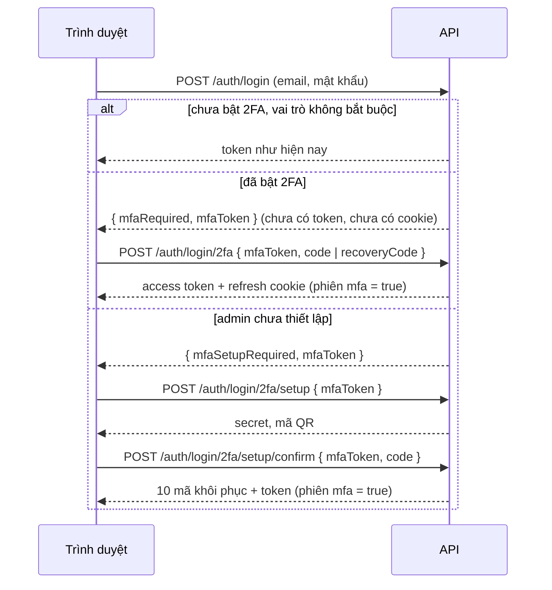

# Phase 15: Xác thực hai lớp (2FA) bằng ứng dụng TOTP (đã duyệt, đã triển khai)

## 1. Mục tiêu

- Lộ mật khẩu (dùng chung mật khẩu ở trang khác, bị lừa gõ vào trang giả) **không đủ** để vào tài khoản. Cần thêm một mã 6 số từ ứng dụng trên điện thoại (Google Authenticator, Microsoft Authenticator, Authy…), mã này đổi mỗi 30 giây.
- **Bắt buộc với quản trị viên**: tài khoản admin hoàn tiền, khóa người dùng, cấp quyền, xóa sự kiện. Ban tổ chức, nhân viên soát vé, khách **tự chọn** bật.
- Mất điện thoại vẫn vào lại được: **mã khôi phục** dùng một lần, admin khác **đặt lại 2FA**, hoặc chạy script trên máy chủ.

## 2. Phạm vi

| # | Việc |
|---|---|
| 1 | TOTP theo RFC 6238 viết tay bằng `node:crypto` (khoảng 40 dòng, có test vector của RFC), không thêm thư viện |
| 2 | Bảng `user_totp` (secret **mã hóa AES-256-GCM**), `user_recovery_codes` (chỉ lưu HMAC); cột `refresh_tokens.mfa` |
| 3 | Đăng nhập 2 bước; admin chưa có 2FA bị **buộc thiết lập** ngay khi đăng nhập |
| 4 | Trang tài khoản: bật / tắt 2FA, tạo lại mã khôi phục. Trang admin: cột 2FA, nút **"Đặt lại 2FA"** |
| 5 | Email cảnh báo khi 2FA được bật, tắt, bị admin đặt lại, hoặc một mã khôi phục vừa được dùng |
| 6 | Script `npm run 2fa:reset` trên máy chủ, cho trường hợp admin cuối cùng mất máy |
| 7 | Test backend, Vitest, E2E (đăng nhập admin trong E2E đi qua 2FA thật); Postman tự tính mã TOTP; README, checklist production |

**Không làm**: "ghi nhớ thiết bị này 30 ngày" (refresh cookie 7 ngày nên ít khi phải đăng nhập lại), SMS (tốn tiền, dễ bị chiếm SIM), khóa bảo mật phần cứng / passkey (WebAuthn).

## 3. TOTP hoạt động thế nào

1. Lúc thiết lập, server tạo một **secret ngẫu nhiên 160 bit**, đưa cho điện thoại qua mã QR `otpauth://totp/ETP Tickets:email?secret=…&issuer=ETP Tickets` (hoặc khách gõ tay chuỗi base32).
2. Cả hai bên cùng tính: `mã = HMAC-SHA1(secret, floor(giờ hiện tại / 30 giây))`, lấy 6 chữ số.
3. Server chấp nhận bước thời gian hiện tại **± 1** (lệch đồng hồ tới 30 giây).
4. **Chống dùng lại**: server nhớ bước thời gian cuối cùng đã dùng (`last_used_step`), chỉ nhận mã của bước **mới hơn**. Kẻ nhìn trộm một mã không dùng lại được mã đó trong 30 giây còn lại. Việc này làm bằng `UPDATE … WHERE last_used_step < $step` (compare-and-set): hai request cùng một mã chạy song song thì đúng một request được.

## 4. Dữ liệu (migration)

```sql
CREATE TABLE user_totp (
  user_id           uuid PRIMARY KEY REFERENCES users (id) ON DELETE CASCADE,
  secret_encrypted  text NOT NULL,          -- AES-256-GCM, khóa TOTP_ENCRYPTION_KEY
  enabled_at        timestamptz,            -- NULL = đang thiết lập, chưa xác nhận mã đầu tiên
  last_used_step    bigint NOT NULL DEFAULT 0,
  created_at        timestamptz NOT NULL DEFAULT now()
);
CREATE TABLE user_recovery_codes (
  id         uuid PRIMARY KEY DEFAULT gen_random_uuid(),
  user_id    uuid NOT NULL REFERENCES users (id) ON DELETE CASCADE,
  code_hash  text NOT NULL,                 -- HMAC-SHA256(OTP_SECRET, user + mã)
  used_at    timestamptz,
  created_at timestamptz NOT NULL DEFAULT now(),
  UNIQUE (user_id, code_hash)
);
ALTER TABLE refresh_tokens ADD COLUMN mfa boolean NOT NULL DEFAULT false; -- phiên mở bằng 2FA
```

- **Secret phải mã hóa, không băm được**: server cần secret gốc để tính mã. Lộ bản sao database mà không lộ khóa `TOTP_ENCRYPTION_KEY` thì vẫn không tạo được mã. GCM phát hiện secret bị sửa. Chuỗi lưu có tiền tố phiên bản `v1:` để sau này đổi khóa.
- **Mã khôi phục**: 10 mã dạng `ABCDE-FGH23` (khoảng 50 bit), chỉ hiện **một lần**. Lưu bằng HMAC có khóa, giống mã OTP email; nếu chỉ băm SHA-256 thì vét cạn 2^50 khả năng là làm được. Mỗi mã chỉ dùng một lần (`UPDATE … SET used_at = now() WHERE used_at IS NULL`).

## 5. Luồng và API

### 5.1 Đăng nhập



- **`mfaToken`**: JWT riêng loại `mfa` (không dùng được như access token), sống **5 phút**, mang `sub`, mục đích (`verify` / `setup`) và lựa chọn "ghi nhớ đăng nhập". Mỗi token tối đa **5 lần nhập sai**, chỉ dùng **một lần** (đếm và đánh dấu trong Redis). Redis hỏng thì báo 503 "thử lại", giống mã OTP email: không có chỗ nào khác để đếm an toàn.
- Rate limit `login-2fa`: 10 lần / phút / IP.
- Chỉ người **đã nhập đúng mật khẩu** mới thấy bước 2FA, nên bước này không tiết lộ email nào có tài khoản.

### 5.2 Refresh: chặn phiên thiếu 2FA

`POST /auth/refresh` trả **401 `MFA_REQUIRED`** và thu hồi cả họ token nếu người dùng **cần 2FA** (đã bật, hoặc có vai trò bắt buộc) mà phiên này **không** mở bằng 2FA. Việc này phủ được ba trường hợp:
- Admin đang đăng nhập từ trước khi có Phase 15.
- Một khách **vừa được nâng lên admin** trong lúc đang đăng nhập (vai trò mới chỉ vào token ở lần refresh).
- Thiết bị khác của người vừa bật 2FA.

Web nhận `MFA_REQUIRED` thì đưa về trang đăng nhập kèm thông báo.

### 5.3 Quản lý 2FA của chính mình (`/users/me/2fa`, cần đăng nhập)

| API | Việc | Điều kiện |
|---|---|---|
| `GET /users/me/2fa` | Trạng thái: đã bật chưa, từ khi nào, còn bao nhiêu mã khôi phục, có bắt buộc không | |
| `POST /users/me/2fa/setup` | Tạo secret mới (chưa bật), trả mã QR + chuỗi base32 | nhập lại **mật khẩu** |
| `POST /users/me/2fa/confirm` | Xác nhận mã đầu tiên → **bật**, trả 10 mã khôi phục. Phiên hiện tại được cấp lại (mfa = true), **các phiên khác phải đăng nhập lại** | mã 6 số |
| `POST /users/me/2fa/disable` | Tắt | mật khẩu + mã. Vai trò bắt buộc → 403 `TWO_FACTOR_REQUIRED` |
| `POST /users/me/2fa/recovery-codes` | Tạo 10 mã mới, bộ cũ hết hiệu lực | mã 6 số |

Mã QR do backend vẽ thành ảnh `data:` bằng thư viện `qrcode` đã có (đang vẽ QR vé); CSP đã cho phép `img-src data:`. Web không cần thêm thư viện.

### 5.4 Admin đặt lại 2FA của người khác

- `POST /admin/users/:id/2fa/reset`, kèm **lý do**:
  - Xóa secret và mã khôi phục.
  - Đăng xuất người đó ở mọi nơi (refresh token + denylist).
  - Ghi audit `TWO_FACTOR_RESET`, gửi email báo cho người đó.
- Không tự đặt lại cho mình (`CANNOT_CHANGE_SELF`).
- Người bị đặt lại, nếu là admin, sẽ bị buộc thiết lập lại ở lần đăng nhập tới.
- Script máy chủ: `npm run 2fa:reset -- admin@example.com`, cho trường hợp **không còn admin nào khác** vào được.

### 5.5 Cấu hình

| Biến | Mặc định | Ghi chú |
|---|---|---|
| `TOTP_ENCRYPTION_KEY` | (bắt buộc) | 32 byte base64. **Mất khóa = mọi người phải thiết lập lại 2FA**; sao lưu như các secret khác |
| `TWO_FACTOR_REQUIRED_ROLES` | `ADMIN` | Vai trò bắt buộc 2FA. Không để trống ở production (checklist) |
| `TOTP_ISSUER` | `ETP Tickets` | Tên hiện trong ứng dụng trên điện thoại |

## 6. Web

- **Đăng nhập**:
  - Sau mật khẩu, nếu cần mã → ô nhập 6 số (tự gửi khi đủ 6 số, gợi ý `autocomplete="one-time-code"`), kèm link "Dùng mã khôi phục".
  - Nếu admin chưa thiết lập → màn hình "Thiết lập xác thực hai lớp":
    1. quét QR (hoặc gõ chuỗi);
    2. nhập mã;
    3. **10 mã khôi phục**: nút "Sao chép", "Tải file .txt", ô "Tôi đã lưu các mã này", rồi mới vào trang.
  - `mfaToken` chỉ giữ trong state của trang đăng nhập, không lưu vào storage.
- **Trang tài khoản**: mục "Xác thực hai lớp", gồm trạng thái, các nút Bật / Tắt / Tạo lại mã khôi phục. Admin thấy "Bắt buộc với quản trị viên", không có nút Tắt.
- **Trang người dùng của admin**: cột "2FA", hành động "Đặt lại 2FA" (hộp thoại nhập lý do).

## 7. Kiểm thử

- **Unit**:
  - TOTP với test vector RFC 6238: thời điểm 59 s → `287082`.
  - base32 mã hóa / giải mã.
  - AES-GCM: mã hóa xong giải ra đúng; sửa 1 byte thì báo lỗi.
- **Integration**:
  - Đăng nhập không có 2FA: không đổi gì.
  - Admin bị buộc thiết lập.
  - Bật 2FA tự nguyện → phiên khác bị `MFA_REQUIRED`.
  - Đăng nhập bằng mã đúng, mã sai (5 lần thì `mfaToken` chết), mã khôi phục (dùng một lần).
  - `mfaToken` hết hạn hoặc dùng lần hai.
  - **Hai request cùng một mã TOTP cùng lúc → đúng một được**; dùng lại mã vừa dùng → bị từ chối.
  - Admin không tự tắt được.
  - Admin đặt lại 2FA của người khác: audit, phiên bị thu hồi, không tự đặt lại cho mình.
  - Phiên admin cũ (`mfa = false`) bị chặn ở refresh; khách vừa được nâng lên admin cũng bị chặn.
  - Redis hỏng → 503.
  - Email cảnh báo được đưa vào hàng đợi.
- **E2E**:
  - Admin của môi trường E2E được tạo sẵn với một secret biết trước. Hàm `signIn` tự tính mã khi trang hỏi.
  - Kịch bản mới: admin mới đăng nhập lần đầu → thiết lập (test đọc chuỗi base32 trên trang để tính mã) → lưu mã khôi phục → đăng xuất → đăng nhập lại bằng **mã khôi phục**.
- **Test helper backend**: `createAdmin` đi qua 2FA thật (secret biết trước).
- **Postman**: sau mỗi "Admin đăng nhập" thêm request "Admin nhập mã 2FA". Pre-request script tự tính mã từ biến `adminTotpSecret` (CryptoJS có sẵn trong Postman). Bạn dán chuỗi base32 của admin dev vào biến đó một lần.

## 8. Ước lượng

| Việc | Giờ |
|---|---|
| Backend (TOTP, mã hóa, migration, đăng nhập 2 bước, refresh, quản lý, reset, email, script) | 9 |
| Web (đăng nhập, thiết lập, mã khôi phục, tài khoản, trang admin) | 6 |
| Test backend, Vitest, E2E (kể cả sửa helper đăng nhập admin) | 4 |
| Postman (8 collection), README, checklist | 2 |
| **Tổng** | **≈ 21 giờ** |

## 9. Cần quyết định khi review

1. **Luồng và API** như mục 5 (đăng nhập 2 bước bằng `mfaToken` 5 phút, quản lý ở `/users/me/2fa`). Đồng ý?
2. **Bật 2FA thì các thiết bị khác phải đăng nhập lại**; phiên đang dùng được cấp lại. Đồng ý?
3. **Admin không tự tắt được 2FA**. Mất máy thì dùng mã khôi phục, nhờ admin khác đặt lại, hoặc chạy script trên máy chủ. Đồng ý?
4. **Email cảnh báo** khi bật, tắt, bị đặt lại, hoặc dùng mã khôi phục. Đồng ý?
5. **Vai trò bắt buộc cấu hình được** (`TWO_FACTOR_REQUIRED_ROLES=ADMIN`), máy dev và test cũng bật. Admin dev `admin@etp.local` của bạn sẽ phải quét QR ở lần đăng nhập đầu tiên sau phase này. Đồng ý?
6. **Không làm** "ghi nhớ thiết bị 30 ngày", SMS, passkey. Đồng ý?

**Đã duyệt**: cả 6 điểm như đề xuất.

## 10. Ghi chú triển khai

- **Backend**:
  - `src/utils/totp.js`: base32, HOTP / TOTP, `verifyTotp` (±1 bước, bỏ qua bước ≤ `last_used_step`, so sánh thời gian hằng).
  - `src/utils/crypto.js`: `encryptSecret` / `decryptSecret` (AES-256-GCM, dạng `v1:iv:tag:ciphertext`).
  - Module `auth`:
    - `two-factor.service.js`: đăng nhập bước 2, thiết lập, quản lý, đặt lại, email cảnh báo.
    - `two-factor.repository.js`, `two-factor.routes.js` (`/users/me/2fa`), `two-factor.schemas.js`.
    - `sessions.js`: cấp phiên, dùng chung cho đăng nhập thường và 2FA để hai service không phụ thuộc vòng.
  - Migration `20261014300001000_two-factor`.
  - Admin: `POST /admin/users/:id/2fa/reset`, cột `twoFactorEnabled` trong danh sách người dùng.
  - Script `npm run 2fa:reset -- <email>`.
  - `seed:admin` nhận thêm `ADMIN_TOTP_SECRET`: chỉ cho môi trường test, từ chối khi chạy production.
- **Mã lỗi mới**: `MFA_REQUIRED`, `MFA_TOKEN_INVALID` (401); `TWO_FACTOR_REQUIRED` (403); `INVALID_TWO_FACTOR_CODE`, `WRONG_PASSWORD` (**422**, không phải 401: trên request đã đăng nhập, 401 làm web tự refresh rồi gửi lại); `TWO_FACTOR_ALREADY_ENABLED`, `TWO_FACTOR_NOT_ENABLED`, `TWO_FACTOR_SETUP_NOT_STARTED` (409).
- **Một tình huống tranh chấp tìm ra khi test**:
  - Một `mfaToken` gửi hai lần cùng lúc, mỗi lần một mã hợp lệ của hai bước liền nhau. Request thua có hai kết cục tùy thứ tự: thua ở bước đánh dấu token đã dùng (401), hoặc mã của bước trước đã thành "cũ" vì mã bước sau được ghi nhận trước (422).
  - Cả hai trường hợp đều chỉ có **một** phiên; test kiểm tra đúng điều đó thay vì cố định mã lỗi.
- **Web**:
  - `LoginPage` có 4 bước: mật khẩu → mã / thiết lập → mã khôi phục.
  - Phần dùng chung trong `auth/TwoFactorParts.tsx`:
    - ô mã tự gửi khi đủ 6 số;
    - hướng dẫn quét QR, có khóa nhập tay chia nhóm 4 ký tự;
    - bảng mã khôi phục với nút sao chép / tải `.txt` / "Tôi đã lưu".
  - Trang tài khoản có `TwoFactorSection`; trang người dùng của admin có cột 2FA và nút "Đặt lại 2FA".
  - Phiên bị đóng vì `MFA_REQUIRED` thì báo "Tài khoản của bạn cần xác thực hai lớp".
- **E2E**:
  - Mỗi test đăng nhập bằng một bản sao admin riêng (cùng mật khẩu và secret, `last_used_step` riêng), vì một mã TOTP chỉ dùng được một lần cho mỗi tài khoản.
  - `signIn` tự điền mã khi được đưa secret.
- **Postman**: 7 collection có thêm request "Admin nhập mã 2FA". Pre-request script tự tính mã bằng CryptoJS từ biến `adminTotpSecret`; thuật toán đã đối chiếu với backend trên 2.000 secret ngẫu nhiên, khớp hết.
- **Cấu hình**: `TOTP_ENCRYPTION_KEY` bắt buộc ở mọi nơi chạy API / worker (`.env`, `backend/.env`, docker-compose, E2E, load test); checklist production có thêm mục 2FA.
- **Kiểm thử**:
  - Backend **302 test** (thêm 32: 14 unit TOTP / mã hóa, 18 integration).
  - Web **66 test** (thêm 3).
  - E2E **14 kịch bản** (thêm 2).
  - Độ phủ dòng 95,2%.
