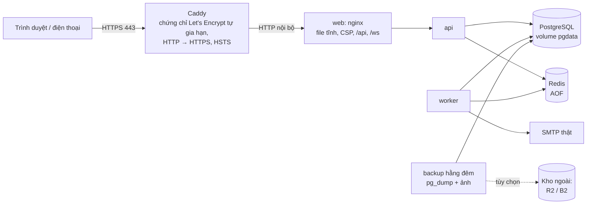

# Phase 16: Đưa lên VPS bằng Docker Compose (đã duyệt, đã triển khai; chờ VPS)

## 1. Mục tiêu

- Web chạy thật ở một tên miền có **HTTPS hợp lệ**, ví dụ `https://ve.ten-mien.vn`. Điện thoại mở camera soát vé không còn cảnh báo chứng chỉ tự ký. VNPay (Phase 17) gọi được về địa chỉ công khai.
- **Mỗi lần push lên `main` mà CI xanh → tự deploy**, có kiểm tra sức khỏe sau khi deploy và quay lại bản trước bằng một lệnh.
- **Không mất dữ liệu**: sao lưu database và ảnh hằng ngày, có hướng dẫn khôi phục và đã khôi phục thử.
- Máy chủ được khóa chặt: chỉ mở cổng 22 / 80 / 443, đăng nhập SSH bằng khóa, tự cập nhật bản vá bảo mật.
- Làm được trước khi có VPS: mọi file cấu hình được **chạy thử trên máy bạn** bằng một bản giống production.

## 2. Kiến trúc trên VPS

- **Chỉ Caddy mở cổng ra Internet** (80, 443). PostgreSQL, Redis, API **không** mở cổng nào ra ngoài.
  - Lưu ý: Docker mở cổng thì đi vòng qua firewall `ufw`, nên tuyệt đối không khai báo `ports:` cho các service còn lại.
- Caddy chỉ lo TLS. Container `web` (nginx) giữ nguyên vai trò như hiện nay: file tĩnh, header bảo mật, chuyển `/api`, `/ws` tới API. Bỏ chứng chỉ tự ký ở production.
- Hai proxy đứng trước API (Caddy → nginx) nên **`TRUST_PROXY=2`**: rate limit vẫn đếm theo IP thật của người dùng.
- **Không dùng**: Mailpit (thay bằng SMTP thật), stack E2E và load test.

## 3. File mới trong repo

| File | Nội dung |
|---|---|
| `deploy/docker-compose.prod.yml` | Các service production: - `caddy`, `web`, `api`, `worker`, `migrate`, `postgres`, `redis`, `backup`; - image gắn **tag theo commit**, `restart: unless-stopped`; - giới hạn RAM từng service, xoay vòng log (`max-size 10m`, 3 file); - không có `ports` ngoài Caddy. |
| `deploy/Caddyfile` | Tên miền, `reverse_proxy web:8080`, HSTS, nén. Bật `tls internal` khi chạy thử trên máy (tên miền `*.localhost`). |
| `deploy/.env.production.example` | Mọi biến cần cho production, có chú thích. File `.env` thật **chỉ nằm trên VPS** (`chmod 600`), không bao giờ vào git. |
| `deploy/scripts/bootstrap-server.sh` | Chạy **một lần** trên VPS mới (Ubuntu 24.04): - tạo user `deploy`; - SSH chỉ cho dùng khóa, cấm đăng nhập root; - `ufw` chỉ mở 22 / 80 / 443; - cài Docker, swap 2 GB, tự cập nhật bản vá (`unattended-upgrades`), `fail2ban`. |
| `deploy/scripts/deploy.sh` | Deploy một commit: - `git fetch` + checkout đúng commit; - `docker compose build` (gắn tag commit); - `migrate`, rồi `up -d`; - **chờ `/health/ready`**: không ổn thì tự quay lại tag trước; - dọn image cũ, giữ 3 bản gần nhất. |
| `deploy/scripts/rollback.sh` | Chạy lại image của commit trước (đã có sẵn trên máy, không cần build). |
| `deploy/scripts/backup.sh`, `restore.sh` | `pg_dump` nén + tar thư mục ảnh: - giữ 7 bản hằng ngày + 4 bản hằng tuần trên VPS; - tùy chọn đẩy lên kho ngoài bằng `rclone`; - `restore.sh` khôi phục vào database **mới** rồi mới đổi sang dùng. |
| `deploy/scripts/smoke.sh` | Sau mỗi deploy: - `/health/ready`; - trang chủ trả 200, có header CSP; - `/api/v1/events` trả 200; - WebSocket nhận được `WELCOME`. |
| `.github/workflows/deploy.yml` | Chạy khi workflow CI trên `main` **thành công** (hoặc bấm tay): - SSH vào VPS bằng khóa riêng cho deploy; - `deploy.sh <commit>`, rồi `smoke.sh` từ máy GitHub. |
| `docs/deployment.md` | Sổ tay từng bước: - thuê VPS, trỏ DNS, chạy bootstrap; - tạo `.env`, deploy lần đầu, tạo admin (quét 2FA); - sao lưu / khôi phục, quay lại bản trước; - đổi secret, xử lý sự cố thường gặp. |

**Sửa file có sẵn**:
- `frontend/docker/nginx.conf`: chứng chỉ tự ký thành tùy chọn (chỉ dùng khi chạy Docker trên máy). Đằng sau Caddy, `X-Forwarded-Proto` lấy theo Caddy.
- `docs/production-checklist.md`: đánh dấu các mục đã tự động hóa.

## 4. Build và deploy

- **Build ngay trên VPS** (đề xuất):
  - VPS kéo code bằng một **deploy key chỉ đọc** của repo, build image tại chỗ, gắn tag là mã commit.
  - Không cần kho image: repo đang private, kho GHCR miễn phí chỉ có 500 MB cho private package, không đủ giữ vài bản backend.
  - Build lỗi thì bản đang chạy không bị ảnh hưởng: build xong mới thay container.
- **Thứ tự mỗi lần deploy**:
  1. build;
  2. sao lưu nhanh database;
  3. `migrate` (migration chỉ đi lên, không bao giờ tự chạy `down` ở production);
  4. `up -d`, chờ `/health/ready`;
  5. smoke test.

  API khởi động lại mất vài giây; chấp nhận được với một máy chủ. Muốn không gián đoạn thì cần 2 bản API sau proxy, đã thử ở Phase 13.2, để sau.
- **Quay lại bản trước**: `rollback.sh` dùng image của commit trước (giữ sẵn 3 bản), không cần build lại. Nếu bản mới đã chạy một migration đổi cấu trúc dữ liệu thì khôi phục từ bản sao lưu ở bước 2 (hướng dẫn trong sổ tay).
- **GitHub Actions** chỉ giữ hai secret: khóa SSH riêng cho deploy và địa chỉ VPS. Mọi secret của ứng dụng nằm trong `.env` trên VPS.

## 5. Cấu hình production (khác với Docker trên máy bạn)

| Mục | Production |
|---|---|
| `NODE_ENV` | `production`. Cookie refresh `Secure`; `seed:admin` từ chối mật khẩu mặc định và `ADMIN_TOTP_SECRET` |
| `CORS_ORIGINS` | `https://<tên miền>` (WebSocket chỉ nhận từ trang của mình) |
| `TRUST_PROXY` | `2` (Caddy + nginx) |
| Redis | Bật **AOF** (`appendfsync everysec`): job đang chờ (email, hết hạn giữ chỗ) không mất khi Redis khởi động lại |
| PostgreSQL | `PG_POOL_MAX` vừa với RAM; dữ liệu trên volume, sao lưu hằng đêm |
| Email | SMTP thật, xem quyết định 4. Với tên miền riêng: bản ghi DNS **SPF, DKIM, DMARC** để không vào spam |
| Secret | Tạo mới trên VPS (`openssl rand`). Không dùng lại secret ở máy bạn hay ở các stack test |
| Admin đầu tiên | `docker compose exec api npm run seed:admin` → đăng nhập → **quét QR 2FA**, cất mã khôi phục |
| Giám sát | Dịch vụ miễn phí (UptimeRobot / Better Stack) gọi `/health/ready` mỗi phút, báo qua email khi sập. Có cảnh báo khi ổ đĩa sắp đầy |

## 6. Chạy thử trước khi có VPS

1. **Trên máy bạn**:
   - `docker compose -f deploy/docker-compose.prod.yml` với tên miền `etp.localhost`;
   - Caddy dùng chứng chỉ nội bộ (`tls internal`);
   - chạy `smoke.sh`;
   - sao lưu rồi khôi phục vào một database mới, so số đơn / vé hai bên.
2. **CI**: thêm một job build image production và chạy smoke test trên chính máy GitHub. Mọi thay đổi về Docker được kiểm tra trước khi tới VPS. Kiểm tra cú pháp các script bằng `shellcheck`.
3. **Khi có VPS**: làm theo `docs/deployment.md`, deploy lần đầu bằng tay rồi bật tự động.

## 7. Việc bạn phải tự làm (tôi hướng dẫn từng bước)

- Thuê VPS, mua tên miền, trỏ bản ghi DNS `A` về IP của VPS.
- Tạo cặp khóa SSH. Thêm deploy key (chỉ đọc) vào repo, thêm 2 secret vào GitHub Actions.
- Tạo `.env` trên VPS bằng các lệnh có sẵn trong sổ tay (secret tạo ngay trên máy chủ, không đi qua chat).
- Tài khoản dịch vụ email, và nếu muốn thì tài khoản kho sao lưu ngoài.
- Không dán mật khẩu, khóa riêng hay nội dung `.env` vào chat.

## 8. Ước lượng

| Việc | Giờ |
|---|---|
| Compose production, Caddy, nginx, cấu hình | 4 |
| Script bootstrap / deploy / rollback / backup / restore / smoke | 5 |
| Workflow deploy + job CI build production | 2 |
| Chạy thử trên máy (deploy, sao lưu → khôi phục, quay lại bản trước) | 3 |
| Sổ tay `docs/deployment.md`, checklist | 2 |
| **Tổng (trước khi có VPS)** | **≈ 16 giờ**; thêm khoảng 2 giờ cùng bạn khi deploy lên VPS thật |

## 9. Cần quyết định khi review

1. **Caddy đứng trước, tự lo HTTPS** (đề xuất): cấu hình vài dòng, tự gia hạn chứng chỉ. Cách khác là nginx + certbot: nhiều bước hơn, dễ quên gia hạn. Đồng ý?
2. **Build image ngay trên VPS** (đề xuất), không dùng kho image GHCR vì giới hạn 500 MB cho repo private. Đồng ý?
3. **Tự deploy mỗi lần `main` có CI xanh** (đề xuất), vẫn có nút bấm tay. Cách khác: chỉ deploy khi bấm tay. Đồng ý?
4. **Email**:
   - Đề xuất: một dịch vụ gửi email giao dịch có gói miễn phí, như **Brevo** (300 email / ngày) hoặc **Resend** (3.000 email / tháng), kèm SPF / DKIM theo tên miền.
   - Cách khác: tạm dùng Gmail SMTP (mật khẩu ứng dụng) như hiện nay. Nhanh, nhưng địa chỉ gửi là Gmail cá nhân, giới hạn khoảng 500 email / ngày, dễ vào spam.

   Bạn chọn bên nào?
5. **Vùng đặt VPS**:
   - Đề xuất **Singapore**: người dùng ở Việt Nam có độ trễ khoảng 30–50 ms. Ví dụ DigitalOcean / Vultr / Linode khoảng 12 USD/tháng cho 2 GB RAM.
   - Cách khác: VPS ở Việt Nam (rẻ, nhanh trong nước).
   - Cách khác: châu Âu (Hetzner rẻ nhất, khoảng 5 €/tháng cho 4 GB, nhưng độ trễ khoảng 200 ms).

   Thiết kế dùng được cho cả ba.
6. **Sao lưu ngoài máy chủ**:
   - Đề xuất: ngoài 7 bản trên VPS, đẩy thêm lên **Cloudflare R2** (10 GB miễn phí) hoặc **Backblaze B2**. VPS hỏng hẳn thì vẫn còn dữ liệu.
   - Cách khác: chỉ dùng snapshot của nhà cung cấp VPS (thường tốn thêm khoảng 20% giá VPS).
7. **Không làm ở phase này**: nhiều máy chủ, Kubernetes, CDN, database được quản lý (managed), hệ thống thu thập log / metrics riêng. Đồng ý?

**Đã duyệt**: theo đề xuất. Chưa chọn email (mục 4) và vùng VPS (mục 5): code dùng được cho mọi lựa chọn.

## 10. Ghi chú triển khai

- **File**:
  - `deploy/docker-compose.prod.yml`, `deploy/Caddyfile`, `deploy/.env.example`.
  - `deploy/scripts/`: `init-env`, `bootstrap-server`, `deploy`, `rollback`, `ci-deploy`, `backup`, `restore`, `smoke`, `offsite-sync`, và `lib.sh` dùng chung.
  - `.github/workflows/deploy.yml`, job "Production stack" trong `ci.yml`, sổ tay `docs/deployment.md`.
- **Khác với bản thiết kế**:
  - Giữ nguyên chứng chỉ tự ký của container `web`: cổng 8443 không mở ra ngoài ở production nên vô hại, và Docker trên máy bạn vẫn dùng nó cho điện thoại.
  - `nginx.conf` chỉ thêm hai việc: chuyển `/health/live|ready` tới API (cho dịch vụ theo dõi và smoke test), và lấy `X-Forwarded-Proto` từ Caddy.
- **An toàn**:
  - Khóa SSH của CI bị **giới hạn lệnh** (`command=` + `restrict` trong `authorized_keys`). `ci-deploy.sh` chỉ nhận `deploy <sha 40 ký tự>`; đã thử 5 kiểu lệnh lạ, đều bị từ chối.
  - Workflow deploy **tắt** cho tới khi có biến `DEPLOY_ENABLED=true`.
  - Mỗi script đặt toàn bộ nội dung trong `main()`, gọi ở dòng cuối, vì `git checkout` có thể ghi đè chính file script đang chạy. Sau khi checkout, `deploy.sh` chạy lại bằng **phiên bản mới** của chính nó.
- **Chạy thử thật trên máy** (bản clone riêng, tên miền `etp.localhost`, chứng chỉ nội bộ của Caddy):
  - Deploy lần đầu khoảng 1 phút (image đã có cache); 5/5 bước smoke đạt.
  - Rate limit đếm theo IP thật (`172.19.0.1`), không phải IP của Caddy; `X-Forwarded-For` giả bị bỏ qua.
  - `seed:admin` ở production từ chối `ADMIN_TOTP_SECRET`; admin đăng nhập lần đầu được yêu cầu thiết lập 2FA.
  - Sao lưu → `restore.sh check` khớp số dòng.
  - Deploy commit thứ hai có bản sao lưu pre-deploy; `rollback.sh` mất 12 giây.
  - `restore.sh apply`: gõ sai xác nhận thì bị hủy; khôi phục thật đưa database từ 4 về đúng 3 người dùng, database cũ được giữ lại.
  - **Deploy bản cố tình hỏng** (API ném lỗi khi khởi động): sau khoảng 2,5 phút tự quay về bản trước, lịch sử không ghi nhận bản hỏng, site phục hồi.
  - Lúc rảnh cả stack dùng khoảng 180 MB RAM.
- **Lỗi tìm ra nhờ chạy thử** (không thể thấy chỉ bằng đọc code):
  1. YAML: thông báo lỗi trong `${CADDY_TLS:?…}` có chuỗi ": " → file Compose không hợp lệ.
  2. WebSocket trong `smoke.sh`:
     - `Sec-WebSocket-Key` phải là đúng 16 byte (dùng khóa mẫu của RFC 6455);
     - phải ép HTTP/1.1 (Caddy nói HTTP/2);
     - với `pipefail`, curl hết giờ chờ (đúng như dự kiến) làm cả pipeline bị coi là lỗi.
  3. `docker compose exec -T` **đọc mất stdin**: lời xác nhận gõ cho `restore.sh apply` bị lệnh docker đầu tiên lấy, script thoát im lặng. Giờ mọi lệnh docker không cần stdin đều đọc từ `/dev/null`, và hỏi xác nhận trước mọi lệnh khác.
  4. Image production ban đầu tên `etp-web:<commit>`, **trùng repository** với `etp-web:latest` của stack dev, nên bước dọn image có thể xóa nhầm. Đổi thành `etp-prod-backend` / `etp-prod-web`.
  5. Sau khi tự quay về bản trước, thư mục code vẫn ở commit hỏng. Giờ checkout lại commit trước để code khớp với image.
  6. Chỉ ảnh hưởng khi chạy thử trên Windows / Git Bash: `docker.exe` cần đường dẫn `C:/…`, và không được đổi `/scripts/…` (đường dẫn trong container) → `cygpath`, `MSYS_NO_PATHCONV`. Trên Linux không có tác dụng.
- **Kiểm tra tĩnh**: `shellcheck` sạch (kể cả mức info), `actionlint` sạch cho cả hai workflow, `docker compose config` hợp lệ.
- **Còn lại khi có VPS**: làm theo `docs/deployment.md` mục 2 → 9 (khoảng 1–2 giờ, phần lớn là chờ DNS và build lần đầu).
