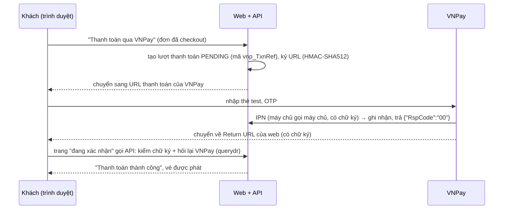

# Phase 17: Thanh toán qua VNPay sandbox (bản thiết kế, chờ duyệt)

Tài liệu VNPay đã đọc khi thiết kế:
- [Thanh toán (pay), IPN, Return URL](https://sandbox.vnpayment.vn/apis/docs/thanh-toan-pay/pay.html)
- [Truy vấn (querydr), hoàn tiền (refund)](https://sandbox.vnpayment.vn/apis/docs/truy-van-hoan-tien/querydr&refund.html)

## 1. Mục tiêu

- Khách trả tiền qua **VNPay** (thẻ ATM nội địa, thẻ quốc tế, VNPay-QR) thay cho nút "giả lập". Ở sandbox không có tiền thật; có thẻ test do VNPay cấp.
- **Không bao giờ bán vé mà chưa nhận tiền, không bao giờ nhận tiền mà không giao vé hoặc hoàn lại**, kể cả khi:
  - khách đóng tab giữa chừng;
  - IPN đến chậm hoặc đến nhiều lần;
  - khách trả ở hai tab;
  - đơn hết giờ đúng lúc khách đang trả.
- Hoàn tiền (admin hoàn, hủy sự kiện) đi qua **API hoàn tiền của VNPay**, có theo dõi trạng thái và thử lại.
- Chạy được trên máy bạn: tunnel (cloudflared) để VNPay gọi IPN vào. Lên VPS (Phase 16) chỉ đổi địa chỉ.

## 2. VNPay hoạt động thế nào



- **IPN** là đường chính để ghi nhận. VNPay gọi tới khi nào nhận được `00` / `02` thì thôi, tối đa 10 lần, cách nhau 5 phút.
- **Return URL** chỉ để hiển thị cho khách. VNPay dặn không cập nhật kết quả từ dữ liệu trên URL này. Thiết kế không tin dữ liệu trên URL: API **hỏi lại VNPay** (querydr) rồi mới ghi nhận. Nhờ vậy:
  - khách thấy kết quả ngay cả khi IPN đến chậm;
  - trên máy bạn, **không có tunnel vẫn trả được tiền**; tunnel chỉ cần để thử chính IPN.
- Ký: sắp xếp các tham số `vnp_*` theo tên, mã hóa URL (khoảng trắng thành `+`), HMAC-SHA512 bằng `vnp_HashSecret`. querydr / refund ký chuỗi các trường nối bằng `|`. Mọi phản hồi của VNPay đều được kiểm chữ ký trước khi đọc.

## 3. Luồng và quy tắc

### 3.1 Bắt đầu thanh toán: `POST /payments/vnpay`

Body `{ orderId }`. Chỉ người mua; đơn `PAYMENT_PENDING` hoặc `PAYMENT_FAILED`.
1. Đơn còn **ít hơn 3 phút** thì từ chối (`ORDER_NOT_PAYABLE`, "không đủ thời gian, hãy đặt lại").
2. Đơn đã có một lượt VNPay `PENDING` (khách bấm lại, hoặc mở tab khác): hỏi VNPay về lượt đó trước.
   - Đã trả → ghi nhận thành công, báo "đơn đã được thanh toán".
   - Chưa trả / không thấy → hủy lượt cũ (`CANCELLED`), tạo lượt mới.
3. Lượt mới:
   - mã `vnp_TxnRef` = id của lượt thanh toán (duy nhất);
   - số tiền = **tổng tiền do server tính** × 100;
   - `vnp_ExpireDate` = **hạn đơn − 2 phút**, để VNPay ngừng nhận tiền trước khi đơn hết hạn và còn 2 phút cho IPN về;
   - `vnp_OrderInfo` = "Thanh toan don ETP-…" (không dấu, như VNPay yêu cầu).
4. Trả về `{ paymentUrl }`; web chuyển trang sang đó.

### 3.2 Ghi nhận kết quả: một hàm, ba đường gọi

`applyGatewayResult(payment, kết quả VNPay)` chạy trong **một transaction**: khóa đơn rồi khóa lượt thanh toán (đúng thứ tự khóa hiện có). Hàm **idempotent**: gọi lại với cùng kết quả thì không làm gì. Ba đường gọi:
- **IPN**;
- **Return URL** (sau khi đã hỏi lại VNPay);
- **đối soát** (mục 3.4).

| Kết quả VNPay | Đơn đang chờ trả | Đơn đã PAID bằng lượt khác / đã hết hạn / đã hủy |
|---|---|---|
| Thành công (`00`) | Lượt → `SUCCESS`, đơn → `PAID`, phát vé (như hiện nay) | **Tiền đến muộn hoặc trả trùng**: lượt → `REFUNDED`, tạo lệnh hoàn tiền tự động, email báo khách |
| Thất bại (hủy, sai OTP, hết hạn…) | Lượt → `FAILED`, đơn → `PAYMENT_FAILED` (giữ ghế, trả lại được) | Chỉ ghi nhận |

IPN trả cho VNPay đúng mã quy định:

| Mã | Khi nào |
|---|---|
| `97` | Sai chữ ký |
| `01` | Không có lượt thanh toán / sai TmnCode |
| `04` | Sai số tiền |
| `02` | Đã ghi nhận trước đó |
| `00` | Vừa ghi nhận |
| `99` | Lỗi khác (VNPay sẽ gọi lại) |

### 3.3 Hoàn tiền: bất đồng bộ qua hàng đợi

- Admin hoàn tiền / hủy sự kiện / tiền đến muộn → trong **một transaction**:
  - đơn → `REFUNDED`, vé hết hiệu lực, ghế mở bán lại (như hiện nay);
  - lượt thanh toán → `REFUNDED`;
  - tạo dòng `refunds` trạng thái **`PENDING`**.
- Sau khi commit, đưa job `vnpay-refund` vào hàng đợi mới `payments`. Worker gọi API refund của VNPay (hoàn toàn phần, `02`):
  - `00` → `SUCCESS` (lưu mã giao dịch hoàn của VNPay);
  - lỗi tạm thời / mạng → thử lại có giãn cách;
  - từ chối hẳn (`91`, `95`, `97`…) hoặc hết số lần thử → `FAILED`, báo admin. Trang đơn của admin có nút **"Hoàn tiền lại"**.
- Lý do làm bất đồng bộ:
  - không gọi API bên ngoài khi đang giữ khóa dòng;
  - hủy một sự kiện có thể phải hoàn hàng trăm đơn;
  - VNPay có thể chậm hoặc tạm lỗi.
- Thanh toán giả lập vẫn hoàn tiền ngay như cũ.

### 3.4 Đối soát: không nhả ghế khi có thể khách đã trả

- Job hết hạn đơn (đúng giờ, và job quét mỗi phút) gặp đơn có lượt VNPay `PENDING` thì **hỏi VNPay trước khi nhả ghế**:
  - đã trả → ghi nhận thành công (đơn `PAID`), không hết hạn;
  - thất bại / không có giao dịch → lượt `CANCELLED`, đơn hết hạn như cũ;
  - VNPay không trả lời → hoãn 1 phút, tối đa 10 phút, rồi mới hết hạn. Nếu sau đó tiền vẫn về thì đi đường "tiền đến muộn" ở mục 3.2 (hoàn tự động).
- Return URL cũng gọi querydr, nên khách quay về là thấy đúng kết quả.

### 3.5 Phương thức thanh toán và giả lập

- `GET /payments/methods` → `["VNPAY", "SIMULATOR"]`. Danh sách tùy cấu hình: VNPay bật khi có `VNPAY_TMN_CODE` và `VNPAY_HASH_SECRET`.
- **Giả lập** bật / tắt bằng `PAYMENT_SIMULATOR`:
  - mặc định **bật** ở máy dev, test, E2E;
  - **tắt** trong `deploy/.env.example` (production): nếu không tắt, ai cũng "trả tiền" miễn phí được.

## 4. Dữ liệu (migration)

- `payments` thêm:
  - `provider_ref` (= `vnp_TxnRef`, `UNIQUE (provider, provider_ref)`);
  - `provider_created_at` (`vnp_CreateDate`, cần cho querydr / refund);
  - `provider_response_code`;
  - `provider_data jsonb` (tham số VNPay đã kiểm chữ ký, bỏ chữ ký đi: để tra cứu khi có tranh chấp).
- `refunds` thêm `failure_message`, `attempts`, `provider_data jsonb`. Trạng thái `PENDING` / `SUCCESS` / `FAILED` đã có sẵn.
- Ràng buộc "mỗi đơn tối đa một lượt `PENDING` hoặc `SUCCESS`" giữ nguyên; tiền đến muộn hoặc trả trùng đi thẳng sang `REFUNDED`.

## 5. Cấu hình

| Biến | Ví dụ / mặc định | Ghi chú |
|---|---|---|
| `VNPAY_TMN_CODE`, `VNPAY_HASH_SECRET` | (từ email đăng ký sandbox) | Secret, chỉ để trong `.env`, không bao giờ ghi log |
| `VNPAY_PAY_URL` | `https://sandbox.vnpayment.vn/paymentv2/vpcpay.html` | |
| `VNPAY_API_URL` | `https://sandbox.vnpayment.vn/merchant_webapi/api/transaction` | querydr, refund |
| `VNPAY_RETURN_URL` | `http://localhost:8080/payments/vnpay/return` | Trang của web; production: `https://<tên miền>/payments/vnpay/return` |
| `PAYMENT_SIMULATOR` | `true` (dev), `false` (production) | |

IPN URL không nằm trong cấu hình của ứng dụng: nó được khai báo với VNPay. Đường dẫn là `<địa chỉ công khai>/api/v1/payments/vnpay/ipn`.

## 6. Thử trên máy bạn: tunnel

- Thêm một service `tunnel` (profile riêng) vào `docker-compose.yml`: **cloudflared** "quick tunnel", không cần tài khoản, mở `https://<tên ngẫu nhiên>.trycloudflare.com` trỏ vào API.

  ```
  docker compose --profile tunnel up -d tunnel
  docker compose logs tunnel        → dòng có https://….trycloudflare.com
  ```

- IPN URL = địa chỉ đó + `/api/v1/payments/vnpay/ipn`. Khai báo trong trang quản trị merchant sandbox của VNPay (đăng nhập bằng thông tin trong email đăng ký).
  - Địa chỉ quick tunnel **đổi mỗi lần chạy**, nên phải khai báo lại.
  - Muốn địa chỉ cố định: tunnel có tên của Cloudflare (cần tên miền trên Cloudflare), hoặc tên miền tĩnh miễn phí của ngrok (cần tài khoản).
- Không có tunnel thì vẫn trả được tiền (đường Return URL + querydr). Chỉ IPN không tới.
- Thử IPN mà không cần VNPay: script `npm run vnpay:ipn -- <mã lượt thanh toán> 00` gửi một IPN **có chữ ký đúng** tới API trên máy (dùng secret của bạn).

## 7. Web

- **Trang đơn** (`PAYMENT_PENDING` / `PAYMENT_FAILED`):
  - nút chính **"Thanh toán qua VNPay"**;
  - hai nút giả lập chỉ hiện khi máy chủ bật giả lập;
  - đơn còn dưới 3 phút thì báo không kịp và gợi ý đặt lại.
- **Trang `/payments/vnpay/return`**: "Đang xác nhận thanh toán…", gọi API, rồi chuyển về trang đơn với kết quả: thành công, thất bại (kèm lý do theo bảng mã VNPay bằng tiếng Việt), hoặc đang chờ xác nhận.
- **Trang đơn của admin**:
  - lượt thanh toán ghi rõ cổng, mã giao dịch VNPay, ngân hàng;
  - trạng thái hoàn tiền: "Đang hoàn qua VNPay", "Đã hoàn", "Hoàn lỗi: … [Hoàn tiền lại]".

## 8. Kiểm thử

- **Unit**:
  - ký và kiểm chữ ký (thứ tự tham số, mã hóa, sửa 1 ký tự là hỏng);
  - giờ GMT+7 dạng `yyyyMMddHHmmss`;
  - chuỗi ký của querydr và refund;
  - đọc bảng mã lỗi.
- **Integration**, với một **VNPay giả** (máy chủ HTTP nhỏ ngay trong test, trả querydr / refund có chữ ký):
  - bắt đầu thanh toán: URL đúng tham số, đúng chữ ký, số tiền × 100, hạn = hạn đơn − 2 phút; còn dưới 3 phút thì bị từ chối;
  - IPN thành công → đơn `PAID`, vé được phát; IPN lặp → `02`; sai chữ ký → `97`; sai số tiền → `04`; không có lượt → `01`;
  - IPN thất bại (`24` khách hủy) → `PAYMENT_FAILED`, trả lại được bằng lượt mới;
  - **IPN và Return URL đến cùng lúc → ghi nhận đúng một lần**;
  - bấm thanh toán lần hai: lượt cũ được hỏi VNPay rồi hủy;
  - **tiền đến muộn** cho đơn đã hết hạn, và **trả trùng** ở hai tab → hoàn tự động;
  - hết hạn đơn có lượt `PENDING`: VNPay báo đã trả → `PAID`; VNPay không trả lời → hoãn;
  - hoàn tiền: thành công / thử lại / thất bại hẳn → admin "Hoàn tiền lại";
  - hủy sự kiện hoàn mọi đơn VNPay qua hàng đợi;
  - giả lập bị tắt → `POST /payments` trả 403.
- **E2E**: VNPay giả dạng trang web (`e2e/support/fake-vnpay.mjs`) chuyển trình duyệt về Return URL với chữ ký đúng. Kịch bản: giữ ghế → checkout → "Thanh toán qua VNPay" → về trang đơn → vé có QR.
- **Thử thật với sandbox** (bạn làm, có hướng dẫn): thẻ test NCB trong email đăng ký, tunnel để thấy IPN tới, khách hủy giữa chừng, admin hoàn tiền.

## 9. Ước lượng

| Việc | Giờ |
|---|---|
| Client VNPay (ký, URL, IPN, querydr, refund), migration | 6 |
| Luồng thanh toán, ghi nhận, đối soát khi hết hạn, tiền đến muộn | 7 |
| Hoàn tiền bất đồng bộ (hàng đợi, thử lại, hủy sự kiện) | 4 |
| Web (trang đơn, trang Return, trang đơn của admin) | 4 |
| Tunnel, script giả IPN, VNPay giả cho E2E | 3 |
| Test unit / integration / E2E, tài liệu, Postman | 5 |
| **Tổng** | **≈ 29 giờ** |

## 10. Cần quyết định khi review

1. **Ghi nhận bằng IPN, và cả Return URL nhưng phải hỏi lại VNPay (querydr)** (đề xuất). Khách thấy kết quả ngay; trên máy không có tunnel vẫn trả được tiền. Đồng ý?
2. **Mỗi lần bấm "Thanh toán qua VNPay" là một lượt mới**: lượt cũ được hỏi VNPay rồi hủy; tiền đến muộn hoặc trả trùng **tự hoàn lại**. Đồng ý?
3. **Hoàn tiền bất đồng bộ**: đơn và vé hết hiệu lực ngay, tiền được hoàn qua hàng đợi, có trạng thái và nút thử lại. Đồng ý?
4. **Giả lập tắt ở production** (`PAYMENT_SIMULATOR=false` trong `deploy/.env.example`), bật ở dev / test. Muốn trang demo trên VPS vẫn có nút giả lập thì bạn tự bật. Đồng ý?
5. **VNPay ngừng nhận tiền 2 phút trước khi đơn hết hạn**; còn dưới 3 phút thì không cho bắt đầu thanh toán. Đồng ý?
6. **Tunnel**: cloudflared quick tunnel (không cần tài khoản; địa chỉ đổi mỗi lần, phải khai báo lại IPN). Cách khác: ngrok có tên miền tĩnh miễn phí nhưng cần tài khoản. Chọn cái nào?
7. **Không làm**: MoMo, chọn ngân hàng ngay trên trang của mình (để VNPay hỏi), hoàn tiền một phần, trả góp / lưu thẻ. Đồng ý?

## 11. Ghi chú triển khai

Đã duyệt cả 7 điểm như đề xuất; tunnel dùng cloudflared.

- **Backend**:
  - `payments/vnpay.js`: client VNPay viết theo tài liệu sandbox. Gồm ký URL / callback (sắp xếp, mã hóa khoảng trắng thành `+`, HMAC-SHA512, so sánh thời gian hằng), `paymentUrl`, `verifyCallback`, `queryTransaction` (querydr) và `refund`; câu trả lời của VNPay được kiểm chữ ký trước khi đọc. Không ghi database, không log secret.
  - `payments/vnpay.service.js`:
    - `startPayment`, `handleIpn`, `confirmReturn`;
    - `applyGatewayResult`: hàm ghi nhận duy nhất, khóa đơn rồi khóa lượt;
    - `reconcileAttempts`: job bảo trì `reconcile-payments`, mỗi phút;
    - `processRefund`: hàng đợi `payments`, 5 lần thử, giãn cách tăng dần;
    - email "Hoàn tiền thanh toán đơn …".
  - `payments/refunds.js`: một chỗ bắt đầu mọi lệnh hoàn tiền (admin, hủy sự kiện, tiền đến muộn). Giả lập thì hoàn ngay; VNPay thì `PENDING` rồi vào hàng đợi sau commit.
  - API mới:
    - `GET /payments/methods`;
    - `POST /payments/vnpay`;
    - `GET /payments/vnpay/ipn` (không đăng nhập, chữ ký là bằng chứng; luôn trả HTTP 200 với `{RspCode, Message}`);
    - `GET /payments/vnpay/return`;
    - `POST /payments/refunds/:id/retry` (quyền `refund:create`).
  - Mã lỗi mới:
    - `PAYMENT_METHOD_DISABLED` (403): giả lập tắt;
    - `PAYMENT_PROVIDER_UNAVAILABLE` (503): không hỏi được VNPay về lượt cũ, nên chưa mở lượt mới;
    - `REFUND_NOT_RETRYABLE` (409).
  - Migration `20261015100001000_vnpay`: cột `provider_*` của `payments` (có `UNIQUE (provider, provider_ref)`), `attempts` / `failure_message` / `requested_by` / `provider_data` của `refunds`.
  - Script dev `npm run vnpay:ipn -- <paymentId> [mã]`: gửi IPN có chữ ký tới API trên máy (từ chối khi `NODE_ENV=production`).
- **Khác hoặc rõ hơn so với thiết kế**:
  - `vnp_TxnRef` là id của lượt **bỏ dấu gạch** (32 ký tự chữ số, đúng dạng VNPay nhận).
  - Hết hạn đơn: job hết hạn thường **bỏ qua** đơn đang có lượt VNPay `PENDING` (điều kiện `NOT EXISTS` trong câu tìm và câu khóa đơn). Chỉ job `reconcile-payments` xử lý các đơn này: hỏi VNPay rồi mới hủy lượt và cho hết hạn. Nhờ vậy job hết hạn không phải gọi ra ngoài.
  - **Lý do thất bại**: querydr chỉ nói "thất bại" (`vnp_TransactionStatus` = `02`). Khi khách quay về, mã trong Return URL (đã kiểm chữ ký, đúng lượt đó: `24` khách hủy, `51` không đủ tiền…) được lưu làm lý do. Kết quả vẫn chỉ quyết định theo VNPay.
  - Giao dịch bị hủy có `vnp_TransactionNo=0`: lưu là trống, không phải mã giao dịch (cột này là duy nhất).
  - `requested_by` của lệnh hoàn = id người bấm, hoặc `system`. `vnp_CreateBy` gửi VNPay = id đó bỏ dấu gạch.
  - **Báo cáo**: hoàn tiền tính vào **ngày tạo lệnh hoàn**, không lọc theo trạng thái, vì đơn đã `REFUNDED` từ lúc đó dù VNPay hoàn sau, hoặc lỗi rồi được gửi lại. Test báo cáo đã sửa theo quy tắc này.
  - Stack Docker trên máy giữ `PAYMENT_SIMULATOR=true`. Stack load test cũng bật, vì chạy `NODE_ENV=production`.
- **Một khoảng hiển thị đã biết**: khi đơn quá hạn mà lượt VNPay còn `PENDING`, ghế vẫn `HELD` trong database nhưng sơ đồ ghế hiện là trống (sơ đồ coi chỗ giữ quá hạn là trống). Người khác bấm giữ ghế đó thì bị từ chối `SEATS_UNAVAILABLE` cho tới khi đối soát xong:
  - thường dưới 1 phút;
  - tối đa 10 phút khi VNPay không trả lời.

  Việc bán không bao giờ sai; chỉ hiển thị lệch trong khoảng đó.
- **Lỗi test tìm ra khi viết**:
  - PostgreSQL không đoán được kiểu khi một tham số dùng hai lần với hai kiểu (`uuid` và `text`; `varchar` trong `CASE`) → ép kiểu rõ ràng.
  - `vnp_TransactionNo=0` của giao dịch hủy đụng ràng buộc duy nhất ở lần hủy thứ hai.
- **Web**:
  - Trang đơn:
    - nút "Thanh toán … qua VNPay";
    - nút giả lập chỉ hiện khi API bật;
    - còn dưới 3 phút thì báo không đủ thời gian;
    - lượt đang chờ VNPay thì báo và tự tải lại;
    - lý do thất bại theo bảng mã VNPay (`payments/vnpayReasons.ts`, có Vitest);
    - mục Hoàn tiền.
  - Trang `/payments/vnpay/return`: thành công → về thẳng trang đơn; thất bại / đang chờ / tiền không dùng được → giải thích.
  - Trang đơn của admin: mã giao dịch VNPay, ngân hàng, lý do, danh sách hoàn tiền (trạng thái, số lần gửi, lỗi) và nút **"Hoàn tiền lại"**.
- **Cấu hình**:
  - `VNPAY_*` và `PAYMENT_SIMULATOR` trong `docker-compose.yml` (dịch vụ `tunnel` chạy với profile `tunnel`, `cloudflare/cloudflared:2026.9.3`), `deploy/docker-compose.prod.yml` (Return URL lấy từ `DOMAIN`) và các `.env.example`.
  - Hướng dẫn production: `docs/deployment.md` mục 13; checklist mục 9.
- **Kiểm thử**:
  - Backend **330 test** (thêm 28):
    - 6 unit (`vnpay`);
    - 21 integration với một VNPay giả chạy HTTP trong test (`tests/helpers/fake-vnpay.js`, kiểm chữ ký request và ký câu trả lời);
    - 1 test giả lập tắt.
  - Web **68 test** (thêm 2).
  - E2E **15 kịch bản** (thêm 1): VNPay giả dạng trang web (`e2e/support/fake-vnpay.mjs`), **viết lại phần ký độc lập với backend**, để hai bản cài đặt kiểm tra lẫn nhau.
  - Độ phủ dòng 95,4%.
- **Postman**: `etp-payments` có thư mục 8 "VNPay sandbox". Nếu API chưa cấu hình VNPay, các bước tự bỏ qua.
