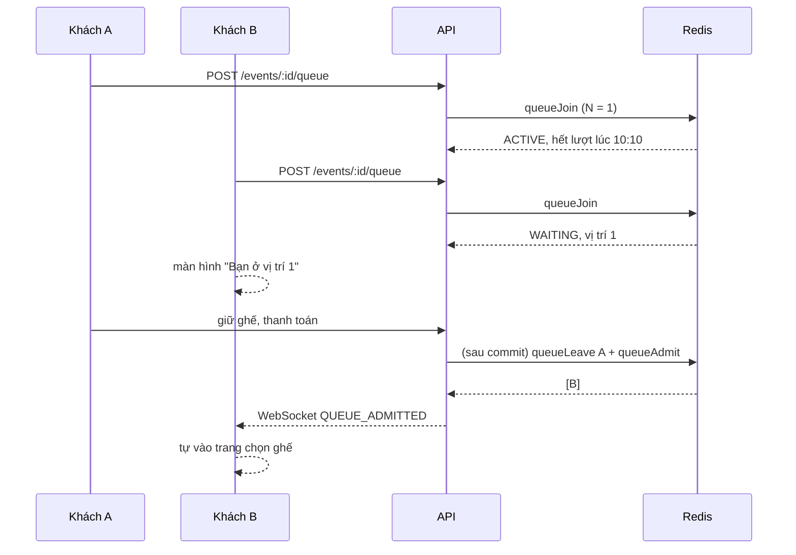

# Phase 21 — Hàng chờ mua vé (phòng chờ ảo)

> Trạng thái: **đã làm** (duyệt cả 5 điểm ở mục 10). Khác thiết kế: xem mục 11.

## 1. Vấn đề

Khi mở bán một sự kiện "hot", hàng nghìn người cùng vào trang chọn ghế một lúc. Hệ thống hiện tại **không bán trùng ghế** (Redis lọc trước, PostgreSQL quyết định), nhưng mọi người tranh nhau cùng lúc nên trải nghiệm rất tệ:
- ghế vừa bấm đã bị người khác lấy (`SEATS_UNAVAILABLE` liên tục);
- API và database chịu toàn bộ cơn sóng request.

Yêu cầu: **"2 người vào mua thì 1 người được vào, 1 người chờ"**. Tức là giới hạn số người **đang mua** của một sự kiện ở mức N. Người đến sau xếp hàng, thấy vị trí của mình, và **tự được vào** khi có người mua xong.

Phân biệt với **danh sách chờ** của Phase 18.4:

| | Danh sách chờ (Phase 18.4) | **Hàng chờ (Phase 21)** |
|---|---|---|
| Khi nào | suất đã **hết vé** | còn vé nhưng **quá đông người mua** |
| Chờ cái gì | có người trả vé | tới lượt được vào chọn ghế |
| Thời gian chờ | có thể vài ngày | vài giây tới vài phút |
| Lưu ở đâu | PostgreSQL | Redis (trạng thái ngắn hạn) |

## 2. Phạm vi

- Hàng chờ tính **theo sự kiện**: mọi suất của một sự kiện dùng chung một hàng. Người đã vào được thì chọn ghế ở bất kỳ suất nào của sự kiện đó.
- **Ban tổ chức hoặc admin bật / tắt** cho từng sự kiện. Mặc định **tắt**, nên sự kiện thường không thay đổi gì.
- **Không làm** trong phase này:
  - hàng chờ toàn hệ thống;
  - tự bật khi đông;
  - ưu tiên theo hạng thành viên;
  - chống bot bằng CAPTCHA.

## 3. Cấu hình (migration `20261019100001000_purchase-queue.sql`)

Bảng `events` thêm 3 cột:

| Cột | Kiểu | Mặc định | Ràng buộc | Ý nghĩa |
|---|---|---|---|---|
| `queue_enabled` | boolean | `false` | | bật hàng chờ |
| `queue_capacity` | int | `100` | 1 – 10.000 | N: số người được mua cùng lúc |
| `queue_session_minutes` | int | `10` | 5 – 30 | thời gian một lượt mua |

- Sửa được cả khi sự kiện **đã đăng**: thêm 3 trường vào `EDITABLE_WHEN_PUBLISHED`, giống `refundPolicy` ở Phase 18.3. Mỗi lần đổi được ghi audit log.
- Giảm N khi đang có người mua: **không đuổi ai ra**. Chỉ là sẽ không cho thêm người vào cho tới khi số người đang mua xuống dưới N mới.
- Tắt hàng chờ: mọi người vào thẳng; dữ liệu hàng chờ trên Redis được xóa.

## 4. Trạng thái trên Redis

Hàng chờ là dữ liệu ngắn hạn, thay đổi rất nhanh (mỗi giây hàng trăm lần vào / hỏi), nên đặt trên Redis, không đặt ở PostgreSQL.

| Key | Kiểu | Nội dung |
|---|---|---|
| `queue:{eventId}:active` | ZSET | member = userId, score = **giờ hết lượt** (ms) |
| `queue:{eventId}:waiting` | ZSET | member = userId, score = **số thứ tự** |
| `queue:{eventId}:seq` | số | bộ đếm số thứ tự (`INCR`) |

- Vị trí của một người là `ZRANK` trong `waiting` cộng 1, tính được ngay (O(log n)).
- Các key có TTL 24 giờ, tự gia hạn mỗi lần dùng, để không để lại rác khi sự kiện kết thúc.

### Lua script (mỗi thao tác là nguyên tử)

Thêm vào `backend/src/redis/scripts.js`:

- **`queueJoin(eventId, userId, N, sessionMs, now)`**:
  1. Bỏ các lượt đã hết giờ: `ZREMRANGEBYSCORE active -inf now`.
  2. Nếu userId đang ở `active` → trả `ACTIVE` kèm giờ hết lượt.
  3. Nếu userId đang ở `waiting` → trả `WAITING` kèm vị trí. Vào lại hoặc tải lại trang **không mất chỗ**.
  4. Nếu `waiting` rỗng và số người active nhỏ hơn N → thêm vào `active` với giờ hết lượt là `now + sessionMs`, trả `ACTIVE`.
  5. Còn lại → `ZADD NX waiting <INCR seq> userId`, trả `WAITING` kèm vị trí.
- **`queueAdmit(eventId, N, sessionMs, now)`**: bỏ lượt hết giờ, rồi lấy người đầu hàng (`ZPOPMIN waiting`) chuyển sang `active` cho tới khi đủ N. Trả về danh sách userId vừa được vào.
- **`queueLeave(eventId, userId)`**: xóa userId khỏi cả `active` lẫn `waiting`.
- **`queueExtend(eventId, userId, untilMs)`**: kéo dài lượt (chỉ kéo dài, không rút ngắn).

Bước 4 kiểm tra "`waiting` rỗng" nên người mới tới **không chen lên trước** người đang chờ, kể cả khi vừa có chỗ trống.

## 5. Luồng

### Cổng chặn

Trong `createOrder` (`backend/src/modules/orders/orders.service.js`), trước bước Redis fast path:
- Nếu sự kiện của suất bật hàng chờ mà người mua **không có lượt active** → lỗi **`QUEUE_TURN_REQUIRED`** (409, thêm vào `backend/src/utils/errorCodes.js`).
- Nếu có lượt → gọi `queueExtend` tới giờ hết hạn giữ chỗ của đơn vừa tạo, để lượt không hết giữa chừng khi đang thanh toán.
- **Không chặn**: sửa đơn đang giữ (BKG-02), checkout, thanh toán, hủy. Người đã giữ được chỗ thì mua nốt, không phải xếp hàng lại.
- Giữ chỗ từ **lời mời của danh sách chờ** (Phase 18.4) không cần lượt: chỗ đó đã được dành riêng cho người được mời.

### Giải phóng lượt

Khi người mua không còn đơn mở nào (HELD / PAYMENT_PENDING) của sự kiện, nghĩa là đơn chuyển sang PAID, CANCELLED hoặc EXPIRED: **sau commit** gọi `queueLeave` + `queueAdmit`. Điểm móc là các chỗ gọi `ordersRepository.transition` tới trạng thái cuối; dùng `client.afterCommit` như các phase trước.

Lượt hết giờ mà chưa giữ chỗ gì thì `queueAdmit` tự bỏ (bước 1 của script).

### Job `admit-queues`

Lịch chạy mới trong `backend/src/worker.js`, mỗi **5 giây**: với mỗi sự kiện đang bật hàng chờ và có người chờ, gọi `queueAdmit` rồi báo cho người được vào. Đây là lưới an toàn cho lượt hết giờ và cho các lần gọi sau commit bị lỡ (API khởi động lại, Redis chập chờn).

### Báo lượt

- Người được vào nhận tin WebSocket **`QUEUE_ADMITTED`** `{ eventId, turnEndsAt }` qua room `user:{id}` (dùng `publish` ở `backend/src/realtime/publisher.js`).
- Màn hình chờ vẫn hỏi lại `GET /events/:id/queue` **mỗi 5 giây**: vừa cập nhật vị trí, vừa dự phòng khi mất WebSocket.

### Redis lỗi

**Cho qua** (không chặn mua) và ghi log cảnh báo. Hàng chờ chỉ để trải nghiệm công bằng hơn; việc không bán trùng vẫn do PostgreSQL đảm bảo như từ Phase 6. Chặn hết người mua chỉ vì Redis chập chờn là tệ hơn.

## 6. API

| Method | Đường dẫn | Ai | Trả về |
|---|---|---|---|
| `POST` | `/events/:id/queue` | khách đã đăng nhập | `{ enabled, state, place, ahead, turnEndsAt, estimatedWaitSeconds }` |
| `GET` | `/events/:id/queue` | khách | như trên; `state: NONE` nếu chưa vào hàng |
| `POST` | `/events/:id/queue/try` | khách | nút **"Vào ngay"** (thêm sau): xét lại hàng ngay. Còn chỗ (dưới N người đang mua) thì hàng tiến lên theo thứ tự, người đầu hàng vào trước, nên ai đủ chỗ thì vào thẳng; đủ người thì giữ nguyên vị trí. Trả thêm `buying` (số người đang mua). Không bao giờ vượt người đứng trước |
| `DELETE` | `/events/:id/queue` | khách | 204 |
| `GET` | `/events/:id/queue/stats` | ban tổ chức của sự kiện, admin | `{ enabled, capacity, active, waiting }` |

- Sự kiện không bật hàng chờ: `POST` trả `{ enabled: false, state: 'ACTIVE', turnEndsAt: null }`, để web xử lý như nhau.
- `estimatedWaitSeconds` = `ahead / N × thời gian mua trung bình`. Thời gian mua trung bình lấy từ các lượt vừa xong (lưu trên Redis), chưa có số liệu thì dùng một nửa `queue_session_minutes`. Hiển thị dạng "khoảng X phút", không hứa chính xác.
- Rate limit `POST` / `GET` theo người dùng (60 lần / phút), đủ cho việc hỏi mỗi 5 giây.

## 7. Web

- **Trang chọn ghế** (`SeatSelectPage.tsx`): nếu sự kiện bật hàng chờ thì gọi `POST /queue` khi mở trang.
  - **Đang chờ**: hiện component **`WaitingRoom.tsx`** thay cho sơ đồ ghế:
    - "Bạn đang ở vị trí **X**, còn **Y** người phía trước, ước tính khoảng **Z** phút";
    - thanh tiến độ;
    - lời dặn "Đừng tải lại trang, bạn sẽ không mất chỗ".
    - Tới lượt (WebSocket hoặc lần hỏi) thì hiện sơ đồ ghế ngay, kèm thông báo.
  - **Đang có lượt**: thanh trên cùng "Lượt mua của bạn còn mm:ss". Hết giờ mà chưa giữ chỗ → quay lại màn hình chờ.
  - Chưa đăng nhập: vẫn xem được sơ đồ ghế (như hiện nay); bấm "Giữ chỗ" thì đăng nhập rồi mới vào hàng.
- **Form sự kiện** (`EventEditorPage.tsx`): mục "Hàng chờ mua vé" có công tắc bật, ô số người mua cùng lúc và ô số phút mỗi lượt.
- **Trang bán hàng** của ban tổ chức và admin: "Đang mua: 87 / 100 · Đang chờ: 1.240", cập nhật mỗi 10 giây.
- Thông báo lỗi `QUEUE_TURN_REQUIRED` được dịch sang tiếng Việt trong `frontend/src/api/errors.ts`.

## 8. Test

- **Unit**: tính `estimatedWaitSeconds`; schema cấu hình (giới hạn N và số phút).
- **Tích hợp** `backend/tests/integration/queue.test.js` (Redis thật, database 15):
  1. Sự kiện không bật → giữ chỗ bình thường.
  2. N = 1: A `ACTIVE`; B `WAITING` vị trí 1; B giữ chỗ → `QUEUE_TURN_REQUIRED`.
  3. A thanh toán → B được vào và nhận tin WebSocket `QUEUE_ADMITTED`.
  4. A hủy đơn / đơn A hết hạn → B được vào.
  5. A hết lượt mà chưa giữ chỗ (chỉnh score trên Redis) → job `admit-queues` cho B vào.
  6. B tải lại (`POST` lần nữa) → vẫn vị trí 1; B rời hàng → C lên vị trí 1.
  7. Người mới không chen trước người đang chờ khi vừa có chỗ trống.
  8. **200 người vào cùng lúc, N = 10** → đúng 10 `ACTIVE`, các vị trí từ 1 tới 190 không trùng, không thiếu.
  9. Lời mời danh sách chờ giữ chỗ được mà không cần lượt.
  10. Redis lỗi → cho qua, có log cảnh báo.
  11. Ban tổ chức bật / sửa cấu hình khi đã đăng (có audit); người khác không xem được `stats`.
- **Web** (Vitest): cách hiển thị thời gian chờ, thanh tiến độ, khi nào phải hiện màn hình chờ (`frontend/src/queue/waitingRoom.ts`). Việc tự chuyển sang sơ đồ ghế được kiểm tra bằng E2E.
- **E2E** `e2e/tests/queue.spec.ts`: 2 trình duyệt, N = 1. A vào chọn ghế; B thấy "vị trí 1". A thanh toán xong → B tự thấy sơ đồ ghế và giữ chỗ được.
- **Load** (Phase 22): kịch bản k6 `queue.js`, kiểm tra không lúc nào số người đang mua vượt N.

## 9. Ước lượng

| Việc | Giờ |
|---|---|
| Migration, cấu hình sự kiện, schema | 1 |
| Lua script, module `queue`, cổng chặn, giải phóng lượt, job | 4 |
| API, WebSocket | 1 |
| Web (màn hình chờ, form, số liệu) | 3 |
| Test tích hợp, web, E2E, tài liệu | 3 |
| **Tổng** | **≈ 12 giờ** |

## 10. Cần quyết định khi review

1. **Mặc định**: N = 100 người mua cùng lúc, 10 phút một lượt. Lượt được kéo dài khi đã giữ chỗ (tới hết hạn giữ chỗ / thanh toán). Đồng ý?
2. **Redis lỗi thì cho qua** (không chặn mua). Đồng ý?
3. Người **đã giữ chỗ** (sửa đơn, thanh toán) và người được **mời từ danh sách chờ** không phải xếp hàng. Đồng ý?
4. Mua xong một suất thì **trả lượt** ngay. Muốn mua thêm suất khác của cùng sự kiện thì xếp hàng lại. Đồng ý?
5. Khách **đã đăng nhập** xếp hàng ngay khi mở trang chọn ghế (sơ đồ ghế chỉ hiện khi tới lượt). Khách **chưa đăng nhập** vẫn xem được sơ đồ; bấm "Giữ chỗ" thì đăng nhập rồi vào hàng. Đồng ý?

## 11. Ghi chú triển khai

Khác thiết kế ban đầu:

- **Tên module là `purchase-queue`**, không phải `queue`, vì `src/queue` đã là hàng đợi job BullMQ (Phase 9). Job bảo trì tên `admit-queues`, chạy mỗi 5 giây.
- **Thứ tự kiểm tra khi giữ chỗ**: cổng chặn hàng chờ đứng **sau** các gợi ý "ghế đã có người lấy / hết vé" của Redis và **trước** khóa ghế trên Redis. Lý do: gợi ý của Redis từ chối mà không đụng tới PostgreSQL (tối ưu của load test Phase 13), còn cổng chặn cần đọc cấu hình sự kiện. Đặt cổng chặn trước thì mọi yêu cầu bị gợi ý từ chối lại tốn thêm một truy vấn; test cũ của Phase 13 đã bắt được điều này.
- **Mọi script đều cho người đầu hàng vào trước** (đoạn `QUEUE_ADMIT` dùng chung): vào hàng, hỏi vị trí, rời hàng hay job đều bỏ lượt hết giờ và lấp chỗ trống từ đầu hàng, rồi mới xếp người mới. Vì vậy người mới không bao giờ chen trước người đang chờ. Giờ lấy từ Redis (`TIME`) để nhiều bản API cùng một đồng hồ.
- **Ước tính thời gian chờ** đơn giản hơn thiết kế: số nhóm N người phía trước × nửa thời gian một lượt. Không đo thời gian mua trung bình thực tế (thêm trạng thái trên Redis mà con số vẫn chỉ để tham khảo).
- **Cấu hình hàng chờ chỉ sửa bằng PATCH** (thẻ "Hàng chờ mua vé" trên trang sửa sự kiện, cả khi nháp lẫn khi đang bán); tạo sự kiện mới luôn tắt hàng chờ. Đổi cấu hình được ghi audit `EVENT_QUEUE_UPDATED` (giá trị cũ / mới).
- Số người đang mua / đang chờ hiện ở thẻ hàng chờ và ở tab "Doanh thu", cập nhật mỗi 10 giây.
- Khách đang có đơn mở (giữ chỗ, chờ thanh toán) không bao giờ thấy màn hình chờ, kể cả khi lượt đã hết.

File chính:

| File | Nội dung |
|---|---|
| `backend/migrations/20261019100001000_purchase-queue.sql` | 3 cột cấu hình trên `events` |
| `backend/src/redis/scripts.js` | `queueJoin`, `queueStatus`, `queueLeave`, `queueExtend`, `queueHasTurn` |
| `backend/src/modules/purchase-queue/` | service (vào hàng, cổng chặn, trả lượt, số liệu, job), routes `/events/:id/queue` |
| `backend/src/modules/orders/orders.service.js`, `order-release.js`, `order-payment.js` | cổng chặn, kéo dài lượt, trả lượt sau commit |
| `frontend/src/queue/`, `pages/customer/WaitingRoom.tsx`, `SeatSelectPage.tsx` | màn hình chờ, hook theo dõi vị trí, đồng hồ lượt mua |
| `frontend/src/organizer/PurchaseQueueCard.tsx` | bật / tắt, N, số phút; số người đang mua / chờ |
| `backend/tests/integration/purchase-queue.test.js`, `backend/tests/unit/purchase-queue.test.js`, `frontend/src/queue/waitingRoom.test.ts`, `e2e/tests/queue.spec.ts` | test |
