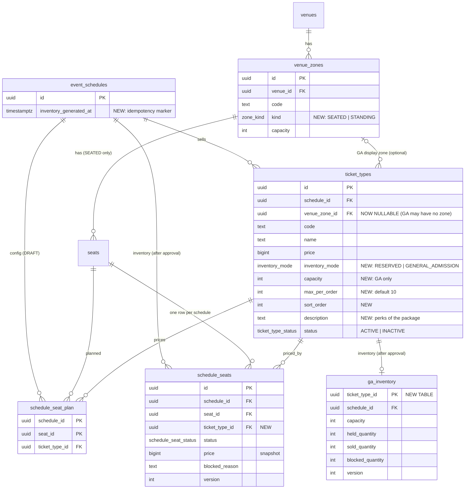

# Phase 4 — Venue layout & ticket inventory (thiết kế, chờ review)

> Trạng thái: **DESIGN ONLY** — chưa viết code. Dựa trên quy trình công khai của CTicket.vn.
> Ngày khảo sát: 09/10/2026.

---

## 1. Khảo sát quy trình công khai của CTicket.vn

### 1.1 Phương pháp và giới hạn
- Truy cập trực tiếp `cticket.vn` **bị chặn**: trình duyệt gặp Cloudflare "Verify you are human", công cụ đọc web nhận HTTP 403.
  Không vượt CAPTCHA. Vì vậy các hành vi dưới đây được xác nhận qua **nguồn thứ cấp công khai**
  (hướng dẫn mua vé, báo chí, trích đoạn trang sự kiện cticket.vn trong kết quả tìm kiếm).
- Không đăng nhập, không đặt vé, không điền form nào.
- Mức tin cậy: **[V]** = đã kiểm chứng (có nguồn ghi rõ) · **[V*]** = có nguồn nhưng là lời mô tả/quảng bá của nhà cung cấp · **[A]** = giả định thiết kế.

### 1.2 Hành vi đã kiểm chứng

| # | Hành vi | Mức | Nguồn |
|---|---|---|---|
| V1 | Luồng mua: trang sự kiện → **"Mua vé ngay"** → (hàng chờ nếu đông) → **chọn hạng vé + số lượng** (hoặc **sơ đồ ghế**) → "Tiếp tục" → **thông tin người nhận** (họ tên, email nhận vé, SĐT, ghi chú) → chọn **phương thức thanh toán** → thanh toán → **email xác nhận** (mã đơn, ghế, hạng vé, thời gian) → **QR check-in qua email** | V | dauthau.asia (hướng dẫn mua vé hội thảo trên CTicket), cellphones.com.vn (T1) |
| V2 | **Sự kiện không ghế số**: hội thảo bán các hạng "Standard", "Executive VIP", "Enterprise Pack (Gói doanh nghiệp)" — chỉ chọn **hạng + số lượng**, màn xác nhận hiển thị "khu vực" | V | dauthau.asia |
| V3 | **Sự kiện ghế số**: "khu ngồi có số ghế cố định, khán giả cần ngồi đúng vị trí theo số ghế ghi trên vé" (SAO Concert trên cticket.vn) | V | trích đoạn trang `cticket.vn/event/sao-concert-tram-2` |
| V4 | **Một sự kiện trộn nhiều kiểu**: BIGBANG Hà Nội (bán độc quyền trên CTicket) có 10 hạng — khu **đứng** (Standing Zone, Ultimate VIP Package) và khu **ngồi** (Premium Seating, CAT 1–5, CAT 5 Restricted View) | V | sammfy.vn, dantri.com.vn |
| V5 | **Nhiều hạng vé/giá trong một suất** (BIGBANG: 1.000.000 → 10.500.000đ); **gói vé** kèm quà/quyền lợi (photocard, lanyard, **ưu tiên check-in**) | V | sammfy.vn; T1: mọi hạng kèm merchandise (tuoitre.vn/plo) |
| V6 | **Hạng ngồi có thể được xếp ghế theo cụm**: "Ở hạng GOLD BB, ghế được chia thành nhiều cụm có lối đi ngăn cách, nên một số đơn hàng mua nhiều ghế có thể không được ngồi liền kề nhau" → có hạng ngồi mà khách chọn **hạng + số lượng**, ghế cụ thể do hệ thống phân | V (diễn giải: A) | trích đoạn trang SAO Concert |
| V7 | **Giới hạn số vé theo sự kiện**: SAO: tối đa **10 vé/giao dịch**; K-Star Spark: tối đa **6 vé/lần thanh toán**, mỗi thẻ dùng 1 lần | V | trích đoạn SAO; thuvienphapluat.vn |
| V8 | **Giới hạn thời gian**: SAO: **10 phút/lượt chọn vé** và **10 phút thanh toán**/đơn | V | trích đoạn SAO |
| V9 | **Hàng chờ (waiting room)** khi lưu lượng cao, xếp theo thứ tự truy cập; khuyên không tải lại trang. T1: >300.000 người vào phòng chờ cùng lúc | V / V* | dauthau.asia, tech.zingnews.vn |
| V10 | **Nhiều đợt bán**: presale thành viên V.I.P (xác minh qua app đối tác), presale **chủ thẻ VPBank Mastercard** (xác minh thẻ), mở bán chung | V | vietnamnet.vn, sammfy.vn |
| V11 | **Chống bot**: "REAL FAN" (câu hỏi trắc nghiệm về nghệ sĩ thay CAPTCHA), lọc IP/VPN theo địa lý | V* | vietnamnet.vn |
| V12 | **Thanh toán**: chuyển khoản ngân hàng (QR, đúng số tiền + nội dung), thẻ nội địa/quốc tế, ví điện tử | V | dauthau.asia, tech.zingnews.vn |
| V13 | **Kho vé tập trung, cập nhật thời gian thực**, "tránh hoàn toàn tình trạng double-booking" | V* | tech.zingnews.vn, vnexpress.net |
| V14 | **Vé eSports**: vé trận, vé ngày, vé vòng, vé cả giải (một vé dùng cho **nhiều suất**); **Team Zone / Fan Zone** theo đội; vé gửi theo từng trận + nhắc giờ | V | vnexpress.net, tech.zingnews.vn |
| V15 | **1 vé = 1 người tham dự**; check-in bằng **QR**; sau bước thanh toán **không đổi được vé** | V | trích đoạn SAO; cellphones.com.vn |

### 1.3 Chưa kiểm chứng được (không có nguồn công khai đọc được)
Chính sách **hoàn/hủy vé**, **chuyển nhượng vé**, cơ chế **giữ chỗ** bên trong (giữ ở đâu, hết hạn thế nào),
giao diện sơ đồ ghế chi tiết (có hiển thị ghế đang được người khác giữ hay không), giới hạn theo **tài khoản** (chỉ thấy theo giao dịch/thẻ).

### 1.4 Giả định thiết kế (từ khoảng trống trên)
| # | Giả định | Lý do chọn |
|---|---|---|
| A1 | Ghế/vé được **giữ (HOLD)** trong thời gian chọn + thanh toán, tự nhả khi hết giờ | Khớp V8 (đồng hồ 10 + 10 phút); là cách duy nhất để không bán trùng khi khách đang thanh toán |
| A2 | Thời gian giữ cấu hình theo hệ thống (mặc định 10 phút), giới hạn vé/đơn cấu hình theo **hạng vé** | V7, V8 cho thấy các con số khác nhau theo sự kiện |
| A3 | Hạng vé ngồi "theo cụm" (V6) = **ghế số nhưng hệ thống tự phân ghế** ("best available") | Giải thích hợp lý nhất cho câu "không được ngồi liền kề" |
| A4 | Hoàn tiền theo chính sách ban tổ chức; v1 chỉ hoàn **toàn phần**, do admin thực hiện | Không có nguồn; đơn giản & an toàn |
| A5 | **Ngoài phạm vi Phase 4** (ghi nhận để làm sau): vé nhiều suất (V14), nhiều đợt bán/presale (V10), waiting room (V9), REAL FAN/geo-filter (V11) | Lớn và độc lập với mô hình kho vé; thiết kế dưới đây không chặn việc thêm sau |

---

## 2. Các quyết định nghiệp vụ → thiết kế

| Yêu cầu | Thiết kế |
|---|---|
| 1. Sinh kho vé **sau khi duyệt**, idempotent | Organizer soạn **cấu hình** (hạng vé, gán ghế) khi event DRAFT. Khi admin duyệt → cùng transaction sinh **kho vé** từ cấu hình. Unique constraints + `ON CONFLICT DO NOTHING` + cột đánh dấu → chạy lại không sinh trùng |
| 2. Nhiều hạng vé/suất; ghế số phải có hạng hợp lệ; GA quản lý sức chứa | `ticket_types.inventory_mode`: `RESERVED` (gán **từng ghế**) hoặc `GENERAL_ADMISSION` (**sức chứa** + bộ đếm held/sold/blocked) |
| 3. Admin quản lý sơ đồ; Organizer quản lý cấu hình event của mình | Venue/zone/seat: chỉ `venue:manage`. Hạng vé, gán ghế: `schedule:manage:own` + kiểm tra chủ sở hữu + event phải DRAFT |
| 4. Khóa/mở ghế hoặc số lượng, bắt buộc lý do, audit | Một API khóa chung cho ghế (RESERVED) và số lượng (GA); `reason` bắt buộc; ghi `audit_logs` cùng transaction |
| 5. Tách ghế vật lý khỏi kho theo suất; GA không cần ghế | `seats` (vật lý) ≠ `schedule_seats` (kho ghế theo suất). GA dùng bảng `ga_inventory`, **không có dòng ghế nào** |
| 6. Chống bán vượt / bán trùng bằng PostgreSQL | Transaction + `FOR UPDATE` + UNIQUE + **UPDATE có điều kiện** + CHECK làm lớp chặn cuối (mục 6) |
| 7. Redis giữ chỗ tạm, PostgreSQL là nguồn sự thật | Phase 6: `SET NX PX` cho ghế; GA chỉ dùng Redis để **từ chối nhanh** khi hết vé, quyết định cuối ở PostgreSQL |
| 8. WebSocket + BullMQ | Phase 7: `SEAT_STATUS_CHANGED`, `INVENTORY_UPDATED` (publish **sau commit**). Phase 9: phát hành N vé cho đơn GA số lượng N qua queue |

---

## 3. Khái niệm cốt lõi

```
                 ADMIN (vẽ 1 lần / địa điểm)                         ORGANIZER (mỗi suất diễn, khi DRAFT)
┌────────────────────────────────────────────┐        ┌────────────────────────────────────────────────┐
│ venue ─┬─ zone "A"   kind=SEATED            │        │ ticket_type "CAT 1"  RESERVED   2.500.000đ      │
│        │    └─ seats A-01 … A-20 (vật lý)   │  ───►  │   gán ghế: zone A hàng 1–5    (seat plan)       │
│        ├─ zone "B"   kind=SEATED            │        │ ticket_type "CAT 2"  RESERVED   1.500.000đ      │
│        └─ zone "PIT" kind=STANDING cap 3000 │        │   gán ghế: zone A hàng 6–10, zone B             │
└────────────────────────────────────────────┘        │ ticket_type "STANDING" GA cap 3000  900.000đ    │
                                                      │   (gắn zone PIT để hiển thị/cổng vào — tùy chọn)│
                                                      └────────────────────────────────────────────────┘
                                                                          │ admin DUYỆT event
                                                                          ▼ (cùng transaction, idempotent)
                                       KHO VÉ CỦA SUẤT ── schedule_seats: 1 dòng / ghế (giá chép từ hạng vé)
                                                       └─ ga_inventory : 1 dòng / hạng GA (capacity, held, sold, blocked)
```

- **Cấu hình** (`ticket_types`, `seat plan`) sửa thoải mái khi DRAFT; **kho vé** chỉ sinh khi duyệt và không đổi cấu trúc nữa.
- Một khu ngồi có thể chia **nhiều hạng giá** (hàng đầu đắt hơn) vì gán theo **từng ghế**, không theo khu.
- GA có thể gắn với khu `STANDING` (để hiển thị trên sơ đồ, phân cổng) **hoặc không gắn gì** (hội thảo — V2).

---

## 4. ERD (phần mới / thay đổi của Phase 4)



### 4.1 Ràng buộc database (lớp bảo vệ cuối)

| Bảng | Ràng buộc | Chặn được gì |
|---|---|---|
| `ticket_types` | `CHECK (inventory_mode = 'GENERAL_ADMISSION') = (capacity IS NOT NULL)`; `capacity > 0`; `max_per_order BETWEEN 1 AND 50` | Hạng ghế số có "sức chứa" ảo; GA không có sức chứa |
| `ticket_types` | `UNIQUE (id, schedule_id)` | Đích cho FK nhiều cột bên dưới |
| `schedule_seat_plan` | `PK (schedule_id, seat_id)`; FK `(ticket_type_id, schedule_id) → ticket_types(id, schedule_id)` | 1 ghế = đúng 1 hạng vé; hạng vé phải **của chính suất đó** |
| `schedule_seats` | (đã có) `UNIQUE (schedule_id, seat_id)`, CHECK trạng thái; **thêm** FK `(ticket_type_id, schedule_id)` | Không sinh trùng ghế; ghế không thể mang hạng vé của suất khác |
| `ga_inventory` | `CHECK (held + sold + blocked <= capacity AND mỗi số >= 0)`; FK `(ticket_type_id, schedule_id)` | **Không bao giờ bán vượt sức chứa**, kể cả khi code có lỗi |
| (service) | Hạng `RESERVED` chỉ gán ghế thuộc venue của suất, khu `SEATED`; hạng GA gắn khu thì khu phải `STANDING` cùng venue | Gán ghế của địa điểm khác |

### 4.2 Thay đổi bắt buộc cho Phase 5 (thiết kế ngay để GA không bị "đóng cửa")
Đơn hàng GA mua **N vé không có ghế**, nên `order_items` và `tickets` phải nới ra (migration ở Phase 5):
- `order_items.schedule_seat_id` → **NULLABLE**; `CHECK ((schedule_seat_id IS NOT NULL AND quantity = 1) OR (schedule_seat_id IS NULL AND quantity >= 1))`; `ticket_type_id` → NOT NULL.
- `tickets.schedule_seat_id` → NULLABLE; bỏ `UNIQUE(order_item_id)`, thay bằng `UNIQUE(order_item_id, admission_no)` (vé thứ 1..N của một dòng GA) — vẫn idempotent khi phát hành lại.
- Unique "1 vé còn hiệu lực / ghế" giữ nguyên (chỉ áp dụng khi `schedule_seat_id IS NOT NULL`).

---

## 5. Máy trạng thái

### 5.1 Event (mở rộng điều kiện của Phase 3)
```
DRAFT ──submit──► PENDING_APPROVAL ──approve──► PUBLISHED
```
**submit** (organizer) — thêm kiểm tra, mọi suất `SCHEDULED` phải:
1. có ≥ 1 hạng vé `ACTIVE`;
2. mọi hạng `RESERVED` có ≥ 1 ghế trong seat plan; mọi hạng GA có `capacity > 0`;
3. (cảnh báo, không chặn) ghế thuộc khu SEATED nhưng chưa được gán hạng → sẽ **không được bán**.

**approve** (admin) — trong **cùng transaction** với việc đổi trạng thái:
lock event `FOR UPDATE` → kiểm tra lại điều kiện submit → **sinh kho vé** cho từng suất → set `inventory_generated_at` → audit `EVENT_APPROVED` + `INVENTORY_GENERATED`.

### 5.2 Hạng vé
```
(DRAFT event) tạo / sửa / xóa tự do
(PUBLISHED)   ACTIVE ⇄ INACTIVE   (tạm dừng bán; giá & sức chứa KHÔNG đổi được)
```
`SOLD_OUT` **không lưu** — tính khi đọc (`available = 0`), tránh trạng thái lệch với bộ đếm.

### 5.3 Ghế trong kho (RESERVED)
```
          block (owner/admin, lý do)            hold (P5)             pay (P8)
BLOCKED ◄────────────────────────── AVAILABLE ──────────► HELD ─────────────► SOLD
        ─────────── unblock ──────────►   ▲                 │                  │
                                          └─ expire/cancel ─┘                  │
                                          └──────────────── refund (P8) ───────┘
```
Chỉ `AVAILABLE ⇄ BLOCKED` thuộc Phase 4. Khóa ghế đang `HELD/SOLD` → bị từ chối (trả về trong danh sách thất bại).

### 5.4 Kho GA (bộ đếm, không có trạng thái từng vé)
```
available = capacity − held − sold − blocked      (CHECK đảm bảo ≥ 0)
hold n     : held    += n   nếu available ≥ n          (P5)
confirm n  : held    −= n , sold += n                    (P8)
release n  : held    −= n                                (P5: hết hạn/hủy)
block n    : blocked += n   nếu available ≥ n            (P4)
unblock n  : blocked −= n   nếu blocked ≥ n              (P4)
refund n   : sold    −= n                                (P8)
```

---

## 6. Chiến lược chống race condition

| Tình huống | Cách chặn | Lớp chặn cuối (DB) |
|---|---|---|
| Hai admin duyệt cùng lúc → sinh kho 2 lần | Lock event `FOR UPDATE` (đã có từ P3): người thứ 2 thấy `PUBLISHED` → 409 | `UNIQUE(schedule_id, seat_id)`, PK `ga_inventory`, `INSERT … ON CONFLICT DO NOTHING` |
| Job/admin chạy lại việc sinh kho (retry) | Sinh kho **idempotent**: `ON CONFLICT DO NOTHING` + kiểm tra `inventory_generated_at` | như trên |
| Organizer sửa hạng vé đúng lúc admin duyệt | Mọi thao tác cấu hình **lock event row** rồi kiểm `status = DRAFT`; duyệt cũng lock row đó → chạy tuần tự | — |
| Khóa ghế đúng lúc khách đang giữ ghế (P5) | `UPDATE schedule_seats SET status='BLOCKED' … WHERE status='AVAILABLE' AND seat_id = ANY($ids) RETURNING seat_id` — một câu lệnh nguyên tử; ghế không đổi được trả về là "thất bại" | CHECK trạng thái/chủ sở hữu ghế |
| GA: 1.000 người mua cùng lúc 10 vé cuối | **UPDATE có điều kiện**: `UPDATE ga_inventory SET held_quantity = held_quantity + $n WHERE ticket_type_id = $1 AND capacity - held_quantity - sold_quantity - blocked_quantity >= $n RETURNING …` — không có "SELECT rồi UPDATE" | `CHECK (held+sold+blocked <= capacity)` |
| Deadlock khi giữ/khóa nhiều ghế | Mọi câu lệnh nhiều ghế sắp `ORDER BY seat_id` (cùng thứ tự với P5) | PostgreSQL phát hiện deadlock → 409 (log là lỗi) |
| GA "hot row" (1 dòng bị tranh chấp) | Câu lệnh rất ngắn (vài ms), không giữ lock lâu; P6: Redis đếm "còn vé" để từ chối nhanh khi hết | CHECK |

**Vì sao không dùng Redis làm bộ đếm GA chính:** Redis có thể mất dữ liệu khi restart và không nằm chung transaction với đơn hàng — nếu Redis nói "còn" mà DB nói "hết", DB thắng. Redis chỉ là **bộ lọc nhanh**.

---

## 7. Hợp đồng API

Base `/api/v1`. Response envelope như các phase trước.

### 7.1 Sơ đồ địa điểm (ADMIN — `venue:manage`)
| Method | Path | Body | Ghi chú |
|---|---|---|---|
| POST | `/venues/:venueId/zones` | `{ code, name, kind: SEATED\|STANDING, capacity? }` | STANDING bắt buộc `capacity` |
| PATCH | `/zones/:id` | `{ name?, capacity? }` | Không đổi `kind` khi đã có ghế |
| POST | `/zones/:id/seats/bulk` | `{ rows: [{ rowLabel, from, to, seatType? }], layout?: { originX, originY, spacing } }` | Tối đa 2.000 ghế/lần; tọa độ tự tính; trả 409 nếu trùng `seat_code` |
| DELETE | `/seats/:id` | — | 409 nếu ghế đã nằm trong seat plan / kho của suất nào |
| GET | `/venues/:id/layout` | — | Công khai: khu + ghế + tọa độ (P6 cache 24h) |

### 7.2 Cấu hình bán vé (ORGANIZER chủ event hoặc ADMIN — event phải DRAFT)
| Method | Path | Body | Ghi chú |
|---|---|---|---|
| GET | `/schedules/:id/ticket-types` | — | Công khai nếu event PUBLISHED |
| POST | `/schedules/:id/ticket-types` | `{ code, name, price, inventoryMode, capacity?, venueZoneId?, maxPerOrder?, description? }` | 201 |
| PATCH | `/ticket-types/:id` | các trường trên | Sau khi PUBLISHED chỉ đổi `status` (ACTIVE/INACTIVE) |
| DELETE | `/ticket-types/:id` | — | Chỉ khi DRAFT |
| GET | `/schedules/:id/seat-plan` | — | Ghế + hạng vé đã gán + ghế chưa gán |
| PUT | `/schedules/:id/seat-plan` | `{ assignments: [{ ticketTypeId, seatIds? , zoneId?, rows? }] }` | **Thay toàn bộ** plan trong 1 transaction; `zoneId`/`rows` là cách gán nhanh cả khu/hàng |

### 7.3 Kho vé (sau khi PUBLISHED)
| Method | Path | Quyền | Ghi chú |
|---|---|---|---|
| GET | `/schedules/:id/availability` | Công khai | Bước "chọn hạng vé + số lượng" (V1): mỗi hạng `{ id, name, price, mode, available, maxPerOrder }` |
| GET | `/schedules/:id/seat-map` | Công khai | Bố cục + `{ seatId, code, ticketTypeId, price, status }`; ghế HELD quá hạn hiển thị AVAILABLE |
| POST | `/schedules/:id/inventory/block` | Chủ event / Admin | `{ action: BLOCK\|UNBLOCK, reason, seatIds? , ticketTypeId?, quantity? }` → `{ applied: [...], rejected: [{ seatId, status }] }`; audit `INVENTORY_BLOCKED/UNBLOCKED` |
| POST | `/schedules/:id/inventory/generate` | Admin (`event:manage:any`) | Chạy lại sinh kho (idempotent) → `{ created: { reservedSeats, gaTicketTypes } }`; chỉ khi PUBLISHED; có audit. Dùng để sửa sự cố, bình thường không cần |

Mã lỗi mới dự kiến: `TICKET_TYPE_INVALID_SEAT` (422), `SEAT_PLAN_INCOMPLETE` (422), `INVENTORY_NOT_GENERATED` (409), `INSUFFICIENT_INVENTORY` (409), `SEAT_IN_USE` (409).

---

## 8. Kiểm thử bắt buộc

- Ghế A01 **SOLD** ở suất 1 nhưng **AVAILABLE** ở suất 2 (kế thừa P1).
- Sinh kho **2 lần** (gọi lại) → số dòng không đổi; **2 admin duyệt cùng lúc** → 1 thành công, kho đúng 1 bộ.
- Ghế của venue khác / hạng vé của suất khác → bị từ chối (service + FK).
- GA: **50 request đồng thời** giữ 1 vé khi chỉ còn 10 → đúng 10 thành công, `held = 10`, không vượt (test ở P5, hàm đếm làm ở P4).
- Khóa ghế đang HELD → nằm trong `rejected`; khóa thiếu lý do → 422; mỗi lần khóa có 1 dòng audit.
- Organizer sửa hạng vé sau khi PUBLISHED → 422; sửa trong lúc admin đang duyệt → tuần tự, không lẫn.

---

## 9. Ước lượng

| Hạng mục | Giờ |
|---|---|
| Migration (zone kind, ticket type mode, seat plan, ga_inventory, FK nhiều cột) | 3 |
| Sơ đồ địa điểm: khu, sinh ghế hàng loạt, layout | 4 |
| Hạng vé + seat plan (gán nhanh theo khu/hàng) | 5 |
| Sinh kho khi duyệt (idempotent) + kiểm tra khi submit | 4 |
| Availability + seat map | 3 |
| Khóa/mở ghế & số lượng + audit | 3 |
| Test (gồm đồng thời) + Postman | 4 |
| **Tổng** | **≈ 26 giờ** |

---

## 10. Cần quyết định khi review

1. **Gán ghế theo từng ghế** (bảng `schedule_seat_plan`, có cách gán nhanh theo khu/hàng) — cho phép nhiều hạng giá trong một khu. Đồng ý?
2. **Hạng ngồi "hệ thống tự xếp ghế"** (A3/V6): đưa vào Phase 5 dưới dạng tùy chọn của hạng `RESERVED` (`seatSelection: CUSTOMER | AUTO`)?
3. **Ngoài phạm vi** Phase 4–5 (làm sau): vé nhiều suất (V14), presale/đợt bán (V10), waiting room (V9), REAL FAN/geo-filter (V11). Đồng ý?
4. Sau khi PUBLISHED **không cho đổi giá/sức chứa** (chỉ tạm dừng bán) — đồng ý?

---

## Nguồn tham khảo
- dauthau.asia — Hướng dẫn mua vé Hội thảo "Toàn cảnh đấu thầu 2025" trên CTicket: https://dauthau.asia/news/blog/huong-dan-mua-ve-tham-gia-hoi-thao-1781.html
- cellphones.com.vn — Cách săn vé Fan Meeting VPBank presents T1 Vietnam: https://cellphones.com.vn/sforum/cach-san-ve-fan-meeting-vpbank-presents-t1-Vietnam
- Trang sự kiện SAO Concert – Trạm SAO 2 (trích đoạn qua kết quả tìm kiếm; truy cập trực tiếp bị 403): https://cticket.vn/event/sao-concert-tram-2
- tech.zingnews.vn — Giải pháp vé CTicket cho eSports: https://tech.zingnews.vn/giai-phap-ve-cticket-mo-co-hoi-dua-viet-nam-thanh-diem-den-esports-post1610760.html
- vnexpress.net — CTicket ra mắt tính năng bán vé eSports: https://vnexpress.net/cticket-ra-mat-tinh-nang-ban-ve-danh-rieng-cho-cac-giai-esports-4992611.html
- vietnamnet.vn — BIGBANG Hanoi ticket rush puts CTicket technology to the test: https://vietnamnet.vn/en/bigbang-hanoi-ticket-rush-puts-cticket-technology-to-the-test-2547749.html
- sammfy.vn — BIGBANG Hà Nội: 10 hạng vé: https://www.sammfy.vn/articles/730d533eb0
- dantri.com.vn — Cẩn trọng khi săn vé concert BIGBANG: https://dantri.com.vn/giai-tri/can-trong-khi-san-ve-concert-bigbang-de-khong-mat-tien-oan-20260806181728260.htm
- tuoitre.vn/plo — CTicket độc quyền vé Fan Meeting T1: https://tuoitre.vn/plo/cticket-doc-quyen-ve-cho-fan-meeting-huyen-thoai-t1-tai-viet-nam-post885341.html
- thuvienphapluat.vn — Hướng dẫn mua vé VPBank K-Star Spark trên CTicket (trích đoạn qua kết quả tìm kiếm): https://thuvienphapluat.vn/phap-luat/huong-dan-mua-ve-concert-tren-cticket-vn-vpbank-kstar-spark-in-vietnam-2025-dang-nhap-cticket-vn-331443-217101.html
